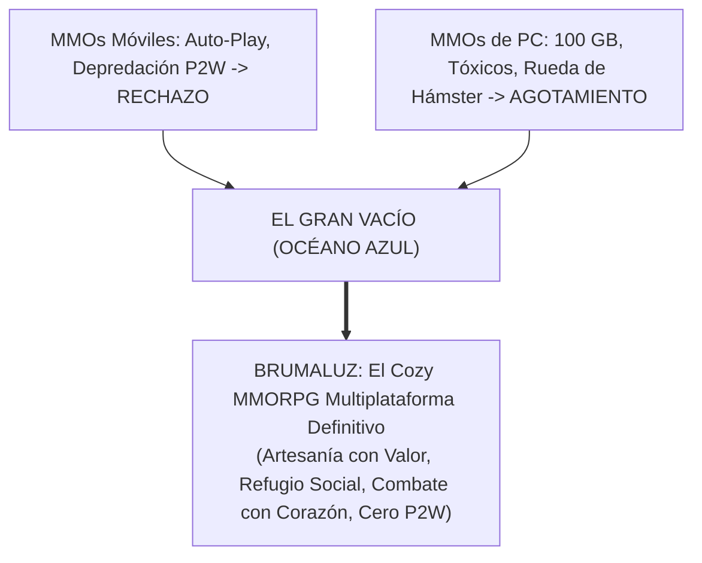
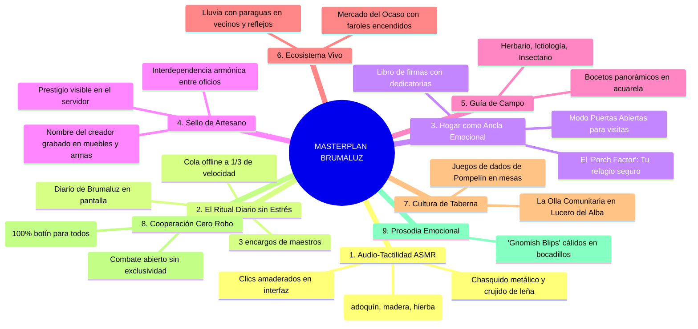
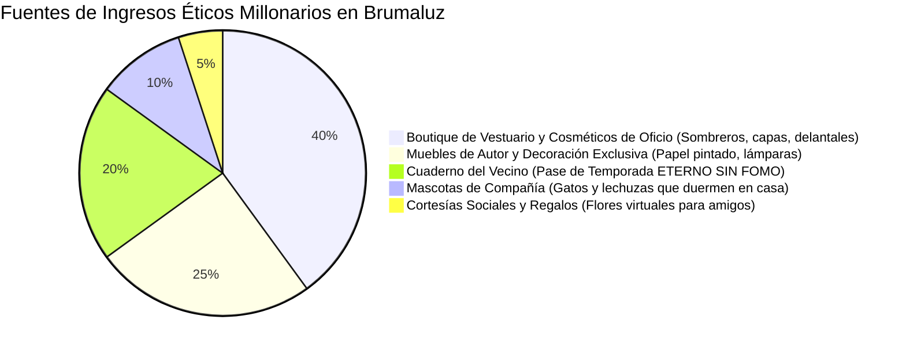
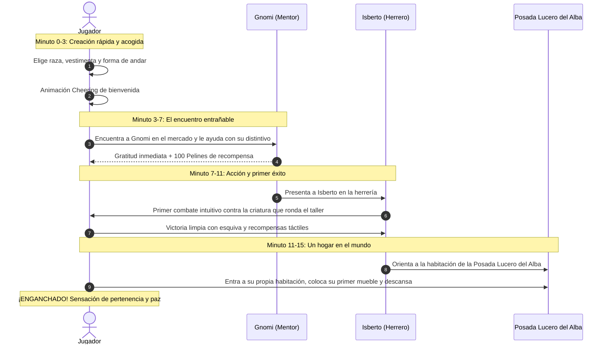
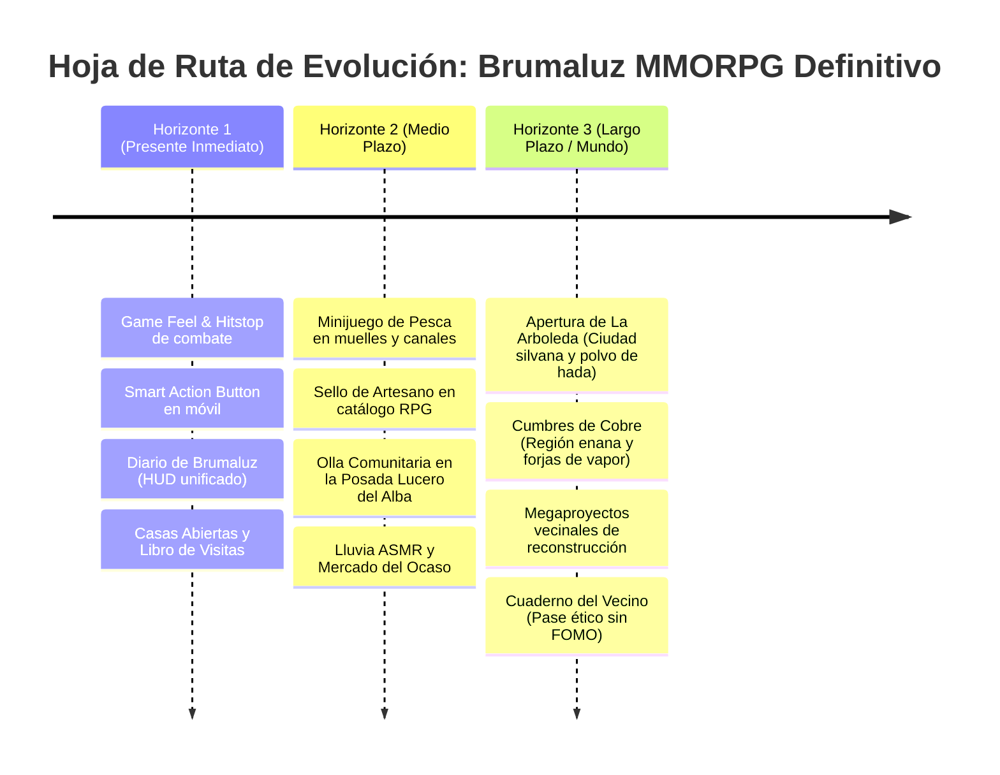

# MASTERPLAN: El MMORPG Cozy Definitivo (PC & Móvil)

> **Documento maestro de visión, arquitectura, diseño de sistemas, psicología de retención y hoja de ruta de producción de Brumaluz.**  
> **Fecha:** 3 de noviembre de 2026.  
> **Ubicación en documentación:** [`docs/MASTERPLAN.md`](docs/MASTERPLAN.md).  
> **Conformidad canónica:** Respeta estrictamente las decisiones aprobadas en [docs/LORE.md](docs/LORE.md), [docs/HOMES-AND-COZY-LIFE.md](docs/HOMES-AND-COZY-LIFE.md) y [docs/RPG-IMPLEMENTATION.md](docs/RPG-IMPLEMENTATION.md).

---

## Índice del Masterplan

1. [La Gran Visión: El Océano Azul de Brumaluz](#1-la-gran-visión-el-océano-azul-de-brumaluz)
2. [El Filtro de Realidad: Lecciones de los Titanes de la Industria](#2-el-filtro-de-realidad-lecciones-de-los-titanes-de-la-industria)
3. [Los Nueve Pilares del Juego](#3-los-nueve-pilares-del-juego)
4. [Ergonomía Multiplataforma: Paridad PC / Móvil](#4-ergonomía-multiplataforma-paridad-pc--móvil)
5. [Monetización Ética Millonaria (Zero Pay-to-Win)](#5-monetización-ética-millonaria-zero-pay-to-win)
6. [El Onboarding Dorado: Los Primeros 15 Minutos](#6-el-onboarding-dorado-los-primeros-15-minutos)
7. [Mapeo Técnico Quirúrgico al Código (`src/` y `supabase/`)](#7-mapeo-técnico-quirúrgico-al-código-src-y-supabase)
8. [Hoja de Ruta por Horizontes (Presente, Medio Plazo y Futuro)](#8-hoja-de-ruta-por-horizontes-presente-medio-plazo-y-futuro)
9. [Cuadro Canónico: Decisiones Aprobadas vs. Propuestas](#9-cuadro-canónico-decisiones-aprobadas-vs-propuestas)

---

## 1. La Gran Visión: El Océano Azul de Brumaluz

El mercado global de videojuegos vive polarizado entre dos extremos agotados:
1. **MMOs móviles automatizados y depredadores:** Con botones de *Auto-Quest* y *Auto-Combat*, ruletas gacha agresivas y microtransacciones *Pay-to-Win*. El jugador no juega: solo mira barras de progreso mientras vacía su cuenta bancaria.
2. **MMOs de PC hardcore y punitivos:** Exigen 30 horas semanales, descargas de 100 GB, comunidades elitistas/tóxicas y un *gear treadmill* (rueda de hámster) que vuelve obsoleto el esfuerzo de los jugadores en cada parche.



### La Regla de Oro de Brumaluz
> **«El juego debe ser irresistible, satisfactorio y autónomo para 1 jugador a solas a medianoche; cálido y cooperativo para 5 personas en la plaza o la taberna; y vivo, vibrante y sostenible con 50 en el servidor.»**

Brumaluz une lo mejor de tres mundos legendarios:
- **La profundidad artesanal y economía con peso** de *Old School RuneScape*.
- **La paz mental, el hogar personal y la estética entrañable** de *Animal Crossing* y *Studio Ghibli*.
- **La cooperación espontánea libre de toxicidad** de *Guild Wars 2* y *Palia*.

---

## 2. El Filtro de Realidad: Lecciones de los Titanes de la Industria

| Referente | Éxito demostrado a incorporar | Error detectado y cómo lo supera Brumaluz |
| :--- | :--- | :--- |
| **Palia** | Recolección cooperativa (*loot* compartido) y atmósfera sin violencia gratuita. | **Eliminaron todo el combate:** Provocó desplome de retención al agotar la artesanía. **Solución Brumaluz:** Combate integrado con botín noble (cueros, tendones, grasas) que alimenta directamente los oficios. |
| **Old School RuneScape** | Paridad total PC/Móvil (misma cuenta/mundo), valor duradero de cada objeto fabricado. | Interfaz de PC miniaturizada con botones difíciles de pulsar. **Solución Brumaluz:** *Smart Action Button* contextual y objetivos táctiles de 44×44 px. |
| **Albion Online** | Arquitectura desacoplada: perfiles de UI móvil y escritorio sobre un mismo servidor. | Alta hostilidad y pérdida de objetos al morir. **Solución Brumaluz:** Muerte piadosa (despertar en la posada Lucero del Alba con infusión caliente). |
| **Helldivers 2 & DRG** | Pases de temporada **eternos sin FOMO** (no caducan jamás). Genera enorme gratitud y compras masivas. | Ninguno en este ámbito: demostraron que monetizar la paciencia y el cariño supera a la ansiedad. |
| **Animal Crossing** | Sinestesia audio-táctil (pasos con sonido por material, clics amaderados, reloj sincrónico). | Multijugador muy limitado y aislado. **Solución Brumaluz:** Mundo persistente compartido y vivo. |

---

## 3. Los Nueve Pilares del Juego



### Detalle de los 9 Pilares:

1. **Audio-Tactilidad y «Game Juice»:**
   - *Hitstop de 30 ms* en impactos de combate para transmitir solidez física.
   - *Números cinéticos flotantes:* Blanco para impactos base, dorado grande con rebote para críticos, verde de curación y azul de Guardia.
   - *Pasos por superficie:* Variación física de sonido según el suelo (adoquín mojado, tarima interior de taller, hierba o alfombra).
2. **El Ritual Diario sin Estrés («El Diario de Brumaluz»):**
   - Panel visual estilo cuaderno que reúne los **3 encargos de maestros** (decisión canon: 50 Pelines en Aprendiz), las **2 meriendas sociales**, los **2 proyectos de vecinos** y el ahorro hacia la **Casa del Olmo (3.500 Pelines)**.
3. **El Hogar como Ancla Emocional y Social:**
   - La habitación de la posada Lucero del Alba (primer hogar) y la Casa del Olmo tienen espacio predefinido para amueblar y decorar.
   - *Modo Puertas Abiertas:* Permite visitas de vecinos sin riesgo de robo de muebles.
   - *Libro de Visitas:* Atril de firmas donde los amigos dejan dedicatorias.
4. **El Sello de Artesano y Economía de Prestigio:**
   - Todo objeto fabricado lleva grabado: *«Forjado con esmero por [Nombre] en Brumaluz»*.
   - Construye reputación para los maestros artesanos sin tablas de clasificación hostiles.
   - Interdependencia armónica: Clavos y bisagras de Herrería para Ebanistería; correas de Peletería para armas; barnices de Alquimia para muebles.
5. **La Guía de Campo de Pompelín (Coleccionismo Contemplativo):**
   - Compendio ilustrado estilo acuarela con cinco pestañas: Herbario, Ictiología (registro de pesca), Insectario y Cuaderno de Bocetos panorámicos.
6. **Ecosistema Vivo y Clima Reactivo:**
   - Lluvia suave con sonido ASMR, adoquines con reflejos dorados de los faroles y vecinos que abren paraguas o se resguardan bajo aleros.
   - El Mercado del Ocaso: Al encenderse las farolas al atardecer, los maestros ofrecen encargos vespertinos con pequeños bonos.
7. **Cultura de Taberna en el Lucero del Alba:**
   - *La Olla Comunitaria:* Caldero donde cualquiera dona verduras; cuando se llena, los novatos se sirven sopa gratis que otorga el beneficio `Reconfortado`.
   - *Minijuegos de Mesa:* Tableros de «Dados de Pompelín» jugables en las mesas de la taberna.
8. **Cooperación Espontánea sin Fricción («Cero Robo de Nodos»):**
   - Si dos jugadores talan el mismo árbol o pican la misma mena, la tarea se acelera y **ambos reciben el 100 % del botín**.
   - Asistir a un vecino en combate otorga crédito y botín individual completo sin disputas.
9. **Prosodia Emocional en Diálogos («Gnomish Blips»):**
   - Murmullos fonéticos melódicos al estilo *Animalese* al desplegar bocadillos de texto de Gnomi, Isberto y los 54 habitantes ambientales.

---

## 4. Ergonomía Multiplataforma: Paridad PC / Móvil

```
+-------------------------------------------------------------+
| EL BOTÓN CONTEXTUAL MAESTRO EN MÓVIL (Smart Action Button)  |
|                                                             |
|   Junto a un roble       --> [ 🪓 TALAR ]                   |
|   Junto a Isberto        --> [ 💬 HABLAR ]                  |
|   Junto a una criatura   --> [ ⚔️ ATACAR ]                  |
|   Junto a una silla      --> [ 🪑 SENTARSE ]                |
|   Junto al agua con caña --> [ 🎣 PESCAR ]                  |
|                                                             |
| * Ubicado en la esquina inferior derecha (Thumb Zone).       |
| * Respuesta háptica ASMR en cada pulsación.                 |
| * Tamaño mínimo garantizado: 56 × 56 px.                     |
+-------------------------------------------------------------+
```

- **Móvil (Sesiones de 5 a 15 min):** Joystick virtual dinámico flotante, Smart Action Button, objetivos táctiles mínimos de 44×44 px, gestión ágil de colas de taller.
- **PC (Sesiones de 45 a 120 min):** WASD o ratón (Click-to-Move), hotkeys 1-9, C, I, M, J, arrastrar y soltar (*drag & drop*) en inventario y colocación milimétrica de muebles.

---

## 5. Monetización Ética Millonaria (Zero Pay-to-Win)



1. **El «Cuaderno del Vecino» Eterno (Zero FOMO):** Siguiendo a *Helldivers 2* y *Deep Rock Galactic*, los pases de temporada **nunca caducan**. Puedes dejar de jugar meses y retomarlo donde lo dejaste.
2. **Cero venta de estadísticas:** Ni daño, ni armadura, ni velocidad, ni Pelines se compran con dinero real. El esfuerzo y el trabajo artesanal son sagrados.
3. **Economía de regalos sociales:** Posibilidad de comprar un ramo de flores o una caja de dulces virtuales para regalar a otro jugador.

---

## 6. El Onboarding Dorado: Los Primeros 15 Minutos



---

## 7. Mapeo Técnico Quirúrgico al Código (`src/` y `supabase/`)

```
src/
├── ui/
│   ├── controls.ts & gameInterface.ts ──> Smart Action Button táctil contextual
│   ├── dailyJournalWindow.ts ───────────> HUD unificado del Diario de Brumaluz
│   ├── homesWindow.ts ──────────────────> Modo visitas vecinales y Libro de Firmas
│   └── itemTooltip.ts ──────────────────> Renderizado del «Sello de Artesano»
├── game/
│   ├── combat.ts ───────────────────────> Hitstop de 30 ms y números cinéticos
│   ├── audio.ts & world/audio.ts ───────> Pasos reactivos por superficie y clics ASMR
│   └── fishing.ts (nuevo) ──────────────> Mecánica de pesca rítmica contemplativa
└── world/
    ├── render.ts ───────────────────────> Detección de suelo para audio de pasos
    ├── waterFx.ts ──────────────────────> Boya y chapoteo de pesca
    └── mapCity.ts ──────────────────────> Olla Comunitaria en la taberna Lucero del Alba

supabase/server/
├── 19c-home-map.sql ────────────────────> Tabla home_guestbook (libro de firmas)
├── 19e-shared-meals.sql ────────────────> Lógica de donación para la Olla Comunitaria
├── 20-professions.sql ──────────────────> Metadato crafter en ItemStack
└── 28-shared-wilderness.sql ────────────> Nodos compartidos (100% loot para todos)
```

---

## 8. Hoja de Ruta por Horizontes (Presente, Medio Plazo y Futuro)



### Horizonte 1: La Fundación Táctil y Vitalidad (Inmediato)
- **Game Feel Engine:** Números flotantes cinéticos, *hitstop* de 30 ms en combate, campana de forja.
- **Smart Action Button:** Botón contextual maestro ergonómico para móviles con háptica.
- **Diario de Brumaluz:** Panel unificado que agrupa los 3 encargos diarios, 2 meriendas, 2 proyectos de vecinos y la meta de 3.500 Pelines.
- **Casas Abiertas:** Modo visitas vecinales y Libro de Firmas en la habitación de la posada.

### Horizonte 2: Ocio, Oficios y Ecosistema Vivo (Medio Plazo)
- **Pesca en Pompelín:** Cañas, cebos, minijuego rítmico, peces coleccionables y recetas culinarias.
- **Sello de Artesano:** Inscripción imborrable del autor en todos los muebles y equipo fabricado.
- **La Olla Comunitaria:** Caldero compartido en la posada Lucero del Alba para apoyo a novatos.
- **Atmósfera reactiva:** Clima de lluvia suave con sonido ASMR, vecinos con paraguas y Mercado del Ocaso diario.

### Horizonte 3: El Gran Mundo Expandido de Pompelín (Largo Plazo)
Conforme a [docs/LORE.md](docs/LORE.md), Brumaluz es la capital de encuentro de regiones autónomas:
1. **Apertura de La Arboleda:** Ciudad silvana frondosa, resolución del misterio del **polvo de hada de Gnomi** y biblioteca artística `brumaluz-arboleda`.
2. **Cumbres de Cobre (Lagto):** Ciudad montañosa de enanos, minería profunda, vagonetas y forjas de vapor (`brumaluz-lagto`).
3. **Rusty Hearts (El Hamlet):** Región gótica y misteriosa (`brumaluz-hamlet`) para investigar la Esencia sombría.
4. **Megaproyectos Vecinales Comunitarios:** Obras masivas de ingeniería civil (reconstruir puentes y faros) donde todo el servidor aporta miles de materiales durante semanas, culminando en festividades compartidas.

---

## 9. Cuadro Canónico: Decisiones Aprobadas vs. Propuestas

| Sistema | Canon Vigente en `docs/` | Cómo se materializa en el Masterplan |
| :--- | :--- | :--- |
| **Viviendas** | Posada Lucero del Alba inicial; Casa del Olmo por 3.500 Pelines; espacio predefinido sin construcción libre de paredes. | Amueblar y decorar se mantienen intactos; se añade Libro de Visitas y modo «Abierto al Vecindario». |
| **Encargos diarios** | Cupo de 3 entregas diarias compartidas entre 12 maestros; objetos fabricados por el personaje; tarifa fija por rango (50 Pelines Aprendiz). | Se muestran y rastrean en el panel centralizado del *Diario de Brumaluz*. |
| **Meriendas sociales** | Recetas aleatorias diarias de Cocina; 2 recompensas/día; ingredientes comunitarios; caducidad a los 30 min inactivo. | Integradas en el Diario; complementadas por la Olla Comunitaria en la taberna. |
| **Fabricación** | Tiempos reales (minutos a horas); avance offline a 1/3; cola de 5 trabajos por oficio (1 activo, 4 en espera). | Se añade el *Sello de Artesano* permanente en el metadato del objeto forjado. |
| **Combate** | 5 clases, Guardia mitigando hasta el 60 %; escalado unificado; criaturas compartidas con botín individual. | Se incorpora *hitstop* de 30 ms, números cinéticos flotantes y telégrafos en el suelo. |
| **Población** | 54 habitantes ambientales con subtítulo «Habitante de Brumaluz», paseos y bocadillos de charla. | Se añade reacción al clima (paraguas) y murmullos fonéticos (*Gnomish Blips*) al hablar. |

---

## Conclusión

El **Masterplan de Brumaluz** sintetiza la sabiduría de dos décadas de historia del videojuego multijugador para resolver la ecuación definitiva: **unir la profundidad de un gran MMORPG con la calidez, la paz y el bienestar de un hogar acogedor en PC y móvil**. 

Este documento es la brújula única y permanente para retomar y guiar todo el desarrollo futuro.
