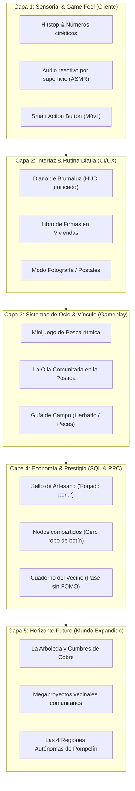
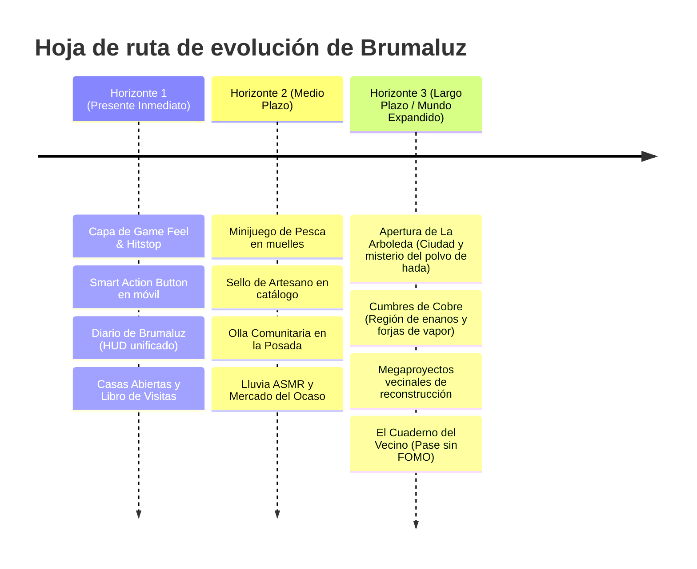

# Guía maestra de implementación técnica y de diseño: El MMORPG cozy definitivo

Documento técnico de arquitectura, especificación de sistemas y mapa de horizontes para `docs/`.
Fecha: 3 de noviembre de 2026.
Carácter: **Especificación técnica detallada y propuesta de integración modular.**
Conforme a [LORE.md](LORE.md) y a las normas del proyecto, las decisiones confirmadas se conservan rigurosamente como canon; las especificaciones de este documento definen **cómo implementar de forma concreta y viable** las propuestas del [Estudio Maestro MMORPG](MMORPG-WHAT-WORKS-STUDY.md) dentro de la arquitectura actual de Brumaluz (`src/`, `supabase/server/`).

---

## 1. Síntesis ejecutiva y arquitectura de integración

Brumaluz cuenta con una base de código excepcionalmente rápida y limpia:
- **Frontend:** Vite + TypeScript + Three.js / WebGL, con renderizado procedural y módulos especializados (`src/world/`, `src/ui/`, `src/game/`).
- **Backend:** PostgreSQL (Supabase) con optimización comprobada de 4,5 ms por sincronización (`supabase/server/18a-rpg-runtime-rules.sql`).
- **Sistemas de vida cozy ya en marcha:** Viviendas (posada Lucero del Alba, Casa del Olmo), 12 talleres, cola offline a 1/3 de velocidad, meriendas sociales y 54 habitantes ambientales (`src/ui/homesWindow.ts`, `src/world/population.ts`, `19b-cozy-life.sql`, `19e-shared-meals.sql`).

La transformación en el **MMORPG cozy definitivo** no exige reescribir el motor, sino **conectar de forma táctil y visceral los sistemas existentes** mediante cinco capas de implementación:



---

## 2. Especificación técnica concreta: Módulos, archivos y cambios exactos

### A. Capa Sensorial & Game Feel (Inmediatez táctil)

#### 1. Números cinéticos flotantes y Hitstop de combate
- **Archivos a modificar:** `src/game/combat.ts`, `src/world/graphics.ts`.
- **Implementación:**
  - Crear un gestor de texto flotante en pantalla (`FloatingCombatText`) instanciado en el canvas o capa DOM ligera (`#combat-text-layer`).
  - Animación con curva Bézier elástica (*bounce-out*): Daño blanco directo, daño crítico dorado (escalado 1,4x con vibración), curación verde flotante y absorción de Guardia azul.
  - Al impactar un golpe crítico o una habilidad pesada, congelar la animación del avatar y del enemigo durante exactamente **30 milisegundos** (`play.hitstopTimer = 0.030`) antes de reanudar el render, produciendo la sensación de impacto físico rotundo.

#### 2. Pasos reactivos por superficie y diseño sonoro ASMR
- **Archivos a modificar:** `src/world/render.ts`, `src/world/audio.ts`, `src/game/audio.ts`.
- **Implementación:**
  - Durante el bucle de animación de carrera/paseo de `src/game/avatar.ts`, detectar en cada zancada el material del suelo bajo los pies mediante un raycast vertical descendente hacia el mapa (`mapCity.ts` o malla de terreno).
  - Materiales mapeados: `stone_cobble` (adoquín húmedo), `wood_plank` (tarima interior de taller/posada), `grass_dense` (hierba de La Arboleda) y `carpet_wool` (alfombras domésticas).
  - Reproducir el sonido correspondiente a través de `WebAudioAPI` con variaciones de tono aleatorias de ±4 % para evitar fatiga auditiva.
  - Incorporar clics amaderados suaves al abrir o mover elementos del inventario (`src/ui/tooltip.ts`, `src/ui/itemTooltip.ts`).

#### 3. Smart Action Button para controles móviles
- **Archivos a modificar:** `src/ui/controls.ts`, `src/ui/gameInterface.ts`, `src/styles/hud.css`.
- **Implementación:**
  - Crear el elemento DOM `#smart-action-button` fijado en la esquina inferior derecha de la pantalla táctil (`touch-action: none; width: 64px; height: 64px`).
  - En cada fotograma de presencia (`updateHud()`), calcular la distancia a la entidad interactiva más cercana en un radio de 2,5 metros:
    ```typescript
    if (nearResource) updateSmartButton('harvest', '🪓', 'Talar / Picar');
    else if (nearNpc) updateSmartButton('talk', '💬', 'Hablar');
    else if (nearEnemy) updateSmartButton('attack', '⚔️', 'Atacar');
    else if (nearChair) updateSmartButton('sit', '🪑', 'Sentarse');
    else if (nearWater && hasFishingRod) updateSmartButton('fish', '🎣', 'Pescar');
    else updateSmartButton('jump', '🦘', 'Saltar');
    ```
  - Disparar `navigator.vibrate(15)` en navegadores móviles compatibles al pulsar el botón para proporcionar retroalimentación háptica.

---

### B. Capa de Rutina Diaria y Vivienda Social

#### 1. El «Diario de Brumaluz» (HUD unificado)
- **Archivos a modificar:** Nuevo componente `src/ui/dailyJournalWindow.ts`, registrado en `src/ui/menus.ts` con tecla rápida `L` y botón en el HUD junto al minimapa.
- **Fuentes de datos conectadas:**
  - `src/data/dailyOrders.ts` -> Encargos de maestros (3 entregas diarias compartidas).
  - `src/ui/sharedMealsPanel.ts` -> Estado de las meriendas comunitarias (2 recogidas diarias).
  - `src/data/neighborhood.ts` -> Proyectos de vecinos (2 completados diarios).
  - `src/data/homes.ts` -> Meta de ahorro hacia la Casa del Olmo (3.500 Pelines).
- **Diseño visual:** Tarjeta desplegable estilo cuaderno de campo con textura de papel pergamino que permite consultar de un vistazo todo el progreso diario sin recorrer menús dispersos.

#### 2. Casas Abiertas y Libro de Visitas en Viviendas
- **Archivos a modificar:** `src/ui/homesWindow.ts`, `src/game/homes.ts`, `supabase/server/19c-home-map.sql`.
- **Implementación SQL:**
  - Añadir columna `access_mode TEXT DEFAULT 'party'` a la tabla de viviendas (valores: `'private'`, `'party'`, `'neighborhood'`).
  - Añadir tabla `home_guestbook`:
    ```sql
    CREATE TABLE IF NOT EXISTS home_guestbook (
      id UUID PRIMARY KEY DEFAULT gen_random_uuid(),
      home_owner_id UUID NOT NULL REFERENCES characters(id),
      visitor_name TEXT NOT NULL,
      visitor_avatar TEXT,
      message TEXT NOT NULL CHECK (char_length(message) <= 120),
      created_at TIMESTAMPTZ DEFAULT now()
    );
    ```
  - En la pestaña `visits` de `homesWindow.ts`, añadir el botón `Permitir al vecindario` y desplegar el registro del libro de visitas con un atril fabricable en Ebanistería.

---

### C. Capa de Ocio & Minijuegos Contemplativos

#### 1. Sistema de Pesca Relajante
- **Archivos a crear:** `src/game/fishing.ts`, `src/world/waterFx.ts` (ampliación), `src/ui/fishingOverlay.ts`.
- **Lógica de juego:**
  1. *Lanzamiento:* El jugador equipa una caña de pescar (creable en Ebanistería/Herrería) y pulsa en la orilla del canal o lago.
  2. *Espera activa:* Animación de sedal con boya flotando en el agua. El audio reproduce chapoteo suave y viento entre juncos.
  3. *¡Pique!:* Tras 8–18 segundos, la boya se sumerge con sonido de chapoteo y vibración háptica.
  4. *Tirón rítmico:* Se abre una pequeña barra curvada en pantalla donde el jugador mantiene una marca verde sobre la silueta del pez durante 3 segundos.
  5. *Captura:* Fanfarria agradable, animación de exhibición del pez en alto y entrega del objeto (Trucha de bruma, Carpa dorada, Cangrejo de río) con XP de Recolección.
- **Destino del pez:** Usado en recetas de Cocina, consumido en meriendas o disecado como trofeo decorativo para colgar en la pared de la casa.

#### 2. La Olla Comunitaria en la Posada Lucero del Alba
- **Archivos a modificar:** `src/world/mapCity.ts`, `supabase/server/19e-shared-meals.sql`.
- **Mecánica:**
  - Un caldero humeante colocado en el salón de la posada.
  - Interactuar abre un menú de donación: cualquier jugador puede aportar vegetales o condimentos.
  - Al alcanzar 20 ingredientes acumulados entre todos los jugadores del servidor, la olla entra en estado «Estofado del Alba listo».
  - Cualquier jugador puede tomar una ración gratuita al día, otorgando el beneficio `Reconfortado` (+5 % regeneración fuera de combate y calor hogareño).

---

### D. Capa de Economía y Prestigio Permanente

#### 1. El «Sello de Artesano» (Legado en objetos)
- **Archivos a modificar:** `supabase/server/18-rpg-catalog.sql`, `supabase/server/20-professions.sql`, `src/ui/itemTooltip.ts`.
- **Estructura de datos:**
  - Ampliar el tipo `ItemStack` / `ItemInstance` con el metadato opcional `crafter: string`.
  - Al completar un trabajo de fabricación en `20-professions.sql`, el servidor inyecta automáticamente el nombre del personaje:
    `crafter = current_character_name`.
  - En `itemTooltip.ts`, si `item.crafter` existe, mostrar en la ficha con tipografía cursiva dorada:
    *«Forjado con esmero por [crafter] en Brumaluz»*.
  - El sello se conserva en el banco, al comerciar y al colocar el mueble en una casa.

#### 2. Nodos de recolección compartidos (Cero robo de recursos)
- **Archivos a modificar:** `supabase/server/28-shared-wilderness.sql`, `src/world/resourceLayer.ts`.
- **Regla técnica:**
  - El nodo de recolección no es exclusivo del primer jugador que hace clic.
  - Si un segundo jugador se une a talar el mismo roble o picar la misma mena, la barra de extracción avanza un 50 % más rápido.
  - Al completarse, **ambos jugadores reciben la tirada completa de materiales y experiencia individualmente**.

---

## 3. Hoja de ruta por horizontes: Del presente inmediato al futuro de Pompelín



### Horizonte 1: La Fundación Táctil y Vitalidad (Próximas entregas)
- **Objetivo:** Hacer que cada minuto en Brumaluz se sienta delicioso a los mandos en PC y móvil.
- **Entregas clave:**
  1. *Game Feel Engine:* Números de daño cinéticos flotantes, *hitstop* de 30 ms en combate, campana de forja y destello dorado al terminar un mueble.
  2. *Smart Action Button:* Botón contextual ergonómico para móviles con respuesta háptica.
  3. *Diario de Brumaluz:* Cuaderno visual que reúne los 3 encargos diarios, 2 meriendas, 2 proyectos de vecinos y la hucha de 3.500 Pelines.
  4. *Casas Abiertas:* Conmutador de visitas vecinales y libro de firmas en la posada Lucero del Alba.

### Horizonte 2: Ocio, Oficios y Ecosistema Vivo (Medio Plazo)
- **Objetivo:** Enriquecer la vida cotidiana de barrio con actividades contemplativas y prestigio artesanal.
- **Entregas clave:**
  1. *Pesca en Pompelín:* Cañas, cebos, minijuego rítmico, especies fluviales y recetas culinarias asociadas.
  2. *Sello de Artesano:* Inscripción imborrable del autor en todos los muebles, armas y herramientas de calidad.
  3. *La Olla Comunitaria:* Caldero compartido en la posada que fomenta la ayuda a los recién llegados.
  4. *Atmósfera reactiva:* Clima de lluvia suave con sonido ASMR, vecinos con paraguas y Mercado del Ocaso diario.

### Horizonte 3: El Gran Mundo Expandido de Pompelín (Horizonte a Futuro)
Conforme a [LORE.md](LORE.md), Brumaluz es la capital común y punto de encuentro de regiones autónomas gobernadas por sus propios soberanos. Este horizonte describe la expansión del universo cuando la base cozy esté consolidada:

1. **Apertura de La Arboleda:**
   - La Arboleda, actualmente representada como bosque exterior frondoso, abrirá el acceso a su ciudad propia.
   - Continuación de la misión del **polvo de hada de Gnomi**, descubriendo la cultura silvana y recetas botánicas avanzadas.
   - Colección artística `brumaluz-arboleda` aplicada a interiores y talleres élficos.
2. **Cumbres de Cobre (Lagto):**
   - Región montañosa de artesanos mineros y maestros de la piedra y el vapor (`brumaluz-lagto`).
   - Mecánicas de ingeniería, forjas de fundición pesada y vagonetas de transporte.
3. **Rusty Hearts (El Hamlet):**
   - Región gótica y misteriosa (`brumaluz-hamlet`) donde se investiga el origen de la Esencia sombría que ronda la herrería de Isberto.
4. **Megaproyectos Vecinales Comunitarios:**
   - Grandes obras de ingeniería civil donde toda la comunidad del servidor colabora durante semanas:
     - *Reconstruir el Gran Molino de Brumaluz:* Requiere 5.000 vigas de roble, 10.000 clavos de bronce y 2.000 telas de vela aportadas entre todos los artesanos.
     - Al completarse, desbloquea una nueva plaza pública con tiendas de semillas exóticas y una fiesta conmemorativa para todo el servidor.

---

## 4. Cuadro canónico: Respeto estricto a las decisiones aprobadas

| Sistema | Decisión confirmada en `docs/` | Cómo se materializa en esta guía |
| :--- | :--- | :--- |
| **Viviendas** | Posada Lucero del Alba inicial; Casa del Olmo a 3.500 Pelines; espacio predefinido, amueblar y decorar sin construcción modular libre de paredes. | Respeta al 100 % las dimensiones fijas; añade Libro de Firmas y conmutador de visitas vecinales. |
| **Encargos diarios** | Cupo único de 3 entregas diarias compartidas entre los 12 maestros; objetos fabricados por el propio personaje; tarifa fija por rango (50 Pelines en Aprendiz). | Los 3 encargos se muestran centralizados visualmente en el panel del *Diario de Brumaluz*. |
| **Meriendas sociales** | Recetas aleatorias diarias de Cocina, 2 recompensas recogidas por personaje y día, ingredientes compartidos, cancelación a los 30 min inactivo. | Se integra su seguimiento en el Diario y se complementa con la Olla Comunitaria en la taberna. |
| **Fabricación** | Tiempos de fabricación reales (minutos a horas), avance offline a 1/3, cola de 5 trabajos por oficio (1 activo, 4 en espera). | Se añade el *Sello de Artesano* (`crafter`) y fanfarria audiovisual al terminar la pieza. |
| **Combate** | 5 clases, Guardia hasta 60 %, escalado unificado, criaturas compartidas con botín individual. | Se incorpora *hitstop* de 30 ms, números cinéticos flotantes y telégrafos claros en el suelo. |
| **Población** | 54 habitantes ambientales con subtítulo compartido «Habitante de Brumaluz», paseos y bocadillos de charla cotidiana. | Se añade reacción al clima (paraguas en lluvia) y murmullos fonéticos melódicos al hablar. |

---

## Conclusión

Esta guía demuestra que la visión del **MMORPG cozy definitivo** no es un sueño inalcanzable, sino un plan de ingeniería y diseño milimétricamente trazado sobre los cimientos que Brumaluz ya tiene construidos. La combinación de tactilidad visceral, bienestar diario sin prisas y un mundo acogedor que respira vida propia sitúa a Brumaluz en posición de convertirse en un fenómeno global en PC y móvil.
