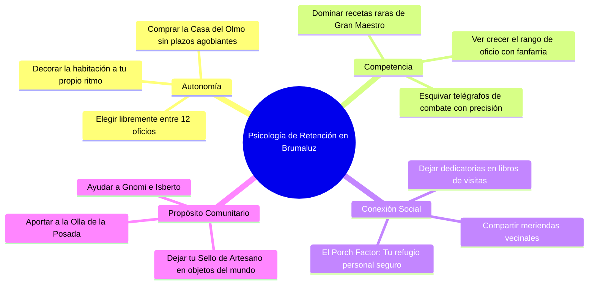
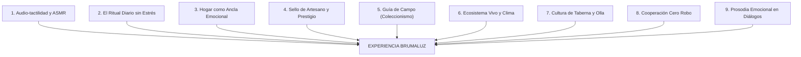
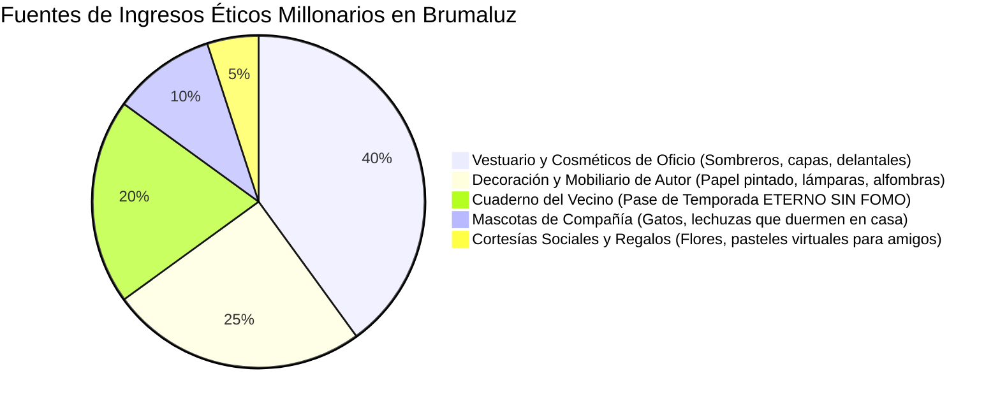
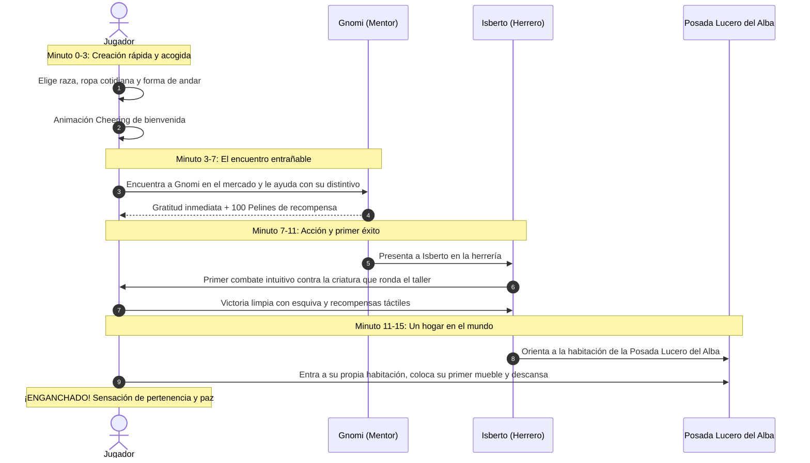
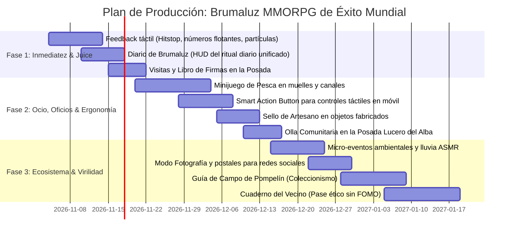

# Tratado definitivo de diseño MMORPG PC/Móvil: El modelo de éxito y retención para Brumaluz

Documento vivo de arquitectura de juego, psicología de retención, modelo de negocio, inmersión sensorial, ergonomía multiplataforma y diseño de sistemas para `docs/`.
Complementado por la [Guía Maestra de Implementación Técnica](MMORPG-IMPLEMENTATION-BLUEPRINT.md).
Fecha: 3 de noviembre de 2026.
Carácter: **Estudio maestro, análisis de mercado global, post-mortems de la industria, dirección de arte interactiva y propuestas de sistemas.**
Conforme a [LORE.md](LORE.md) y a las normas de diseño del proyecto, las decisiones confirmadas se conservan rigurosamente como canon; las propuestas de este estudio se formulan para enriquecer el diseño y quedan pendientes de la aprobación expresa del usuario.

---

## Índice general

1. **La visión suprema: Por qué Brumaluz puede liderar el mercado mundial PC/Móvil**
2. **El secreto de la magia: La estética Ghibli, el «Tercer Lugar» sociológico y la calidez emocional**
3. **Lecciones empíricas de la industria: Post-mortems y casos de éxito reales**
   - *Palia y el error de extirpar el combate: El salvavidas del endgame acogedor*
   - *Old School RuneScape y Albion Online: La arquitectura de perfiles de plataforma*
   - *Deep Rock Galactic y Helldivers 2: El fin del FOMO y la monetización del agradecimiento*
   - *Animal Crossing y Sky: La sinestesia audio-táctil y la prosodia emocional*
4. **Ergonomía multiplataforma revolucionaria: Paridad total y controles hápticos**
   - *El Smart Action Button contextual*
   - *Optimización de la zona de pulgares (Thumb Zones) y objetivos de 44×44 px*
   - *Respuesta háptica ASMR en dispositivos móviles*
5. **Psicología de la retención infinita: El «Porch Factor», el ciclo de dopamina y el estado de flujo**
6. **Los nueve pilares del éxito de Brumaluz: De la diversión local al fenómeno mundial**
   - *Pilar 1: Audio-tactilidad visceral y diseño sonoro ASMR (Pasos por superficie y clics amaderados)*
   - *Pilar 2: El Ritual Diario sin Estrés («El Diario de Brumaluz»)*
   - *Pilar 3: El Hogar como Ancla Emocional y Social (Casas Abiertas y Visitas)*
   - *Pilar 4: El «Sello de Artesano» y la Economía de Prestigio (Legado Permanente)*
   - *Pilar 5: La Guía de Campo de Pompelín (El Gran Coleccionismo Contemplativo)*
   - *Pilar 6: El Ecosistema Vivo Reactivo (Clima Emocional y Ciclos Atmosféricos)*
   - *Pilar 7: La Cultura de la Taberna en el Lucero del Alba (La Olla Comunitaria)*
   - *Pilar 8: Cooperación Espontánea sin Toxicidad («Cero Robo de Nodos»)*
   - *Pilar 9: Prosodia Emocional en Diálogos («Gnomish Blips» y bocadillos visuales)*
7. **El combate con corazón: Aventura heroica sin estrés ni crueldad gratuita**
8. **Mascotas y fauna de compañía: Vínculo afectivo sin estadísticas infladas**
9. **El motor social y viral: «Instagrammability», modo postal y creadores de contenido**
10. **Monetización ética millonaria: Ricos sin Pay-to-Win**
    - *El «Cuaderno del Vecino» Eterno (Zero FOMO)*
    - *Boutique de Vestuario y Muebles de Autor*
11. **El onboarding perfecto: Los primeros quince minutos de oro**
12. **Matriz de ejecución y mapa de ruta de producción (Fases 1, 2 y 3)**
13. **Cuadro canónico: Decisiones aprobadas frente a nuevas propuestas**

---

## 1. La visión suprema: Por qué Brumaluz puede liderar el mercado mundial PC/Móvil

El mercado global de videojuegos vive una saturación extrema de dos extremos polarizados:
1. **MMOs móviles hiper-monetizados y automatizados:** Juegos con botón de «Auto-Quest» y «Auto-Combat», llenos de ruletas gacha agresivas y microtransacciones depredadoras donde el jugador no juega, solo mira barras de progreso mientras vacía su tarjeta. Los jugadores están agotados y desencantados de esta fórmula.
2. **MMOs de PC hardcore y hostiles:** Títulos que exigen 30 horas semanales de dedicación ineludible, con comunidades tóxicas, penalizaciones punitivas y gráficos pesados que requieren descargas de 100 GB y tarjetas gráficas de gama alta.

### El inmenso «Océano Azul»: El Cozy MMORPG Multiplataforma
Entre esos dos extremos existe un público millonario y desatendido: jugadores que aman los mundos compartidos, la fantasía, la artesanía y la sensación de progreso, pero buscan **calidez, belleza, paz mental, juego justo y compatibilidad universal**.

Títulos como *Animal Crossing: New Horizons* (más de 43 millones de copias vendidas), *Stardew Valley* (más de 30 millones), *Genshin Impact* (el fenómeno móvil/PC más rentable de la década), *Old School RuneScape Mobile* (más de 100 millones de dólares generados sin vender poder) y *Palia* demuestran que:
> **La fantasía de tener una segunda vida en un mundo cálido, fabricar tus propios bienes, decorar tu rincón y compartir una taza de té o una aventura con amigos es la fórmula más atractiva, duradera y rentable del mundo.**

Brumaluz, con su dirección confirmada en [LORE.md](LORE.md) (**cozy crafting and building con combate integrado en el mundo de Pompelín**), su cliente web ligero accesible desde navegador o app sin descargas eternas, su arquitectura PostgreSQL de 4,5 ms de sincronización y su estética cuidada de barrio, reúne todas las condiciones para convertirse en el referente indiscutible de esta revolución.

---

## 2. El secreto de la magia: La estética Ghibli, el «Tercer Lugar» sociológico y la calidez emocional

¿Qué transforma a un juego de «correcto» a una **obsesión de culto amada por millones**? La respuesta de diseño no está en más polígonos ni en matemáticas complejas, sino en la resonancia emocional profunda:

### A. El concepto del «Tercer Lugar» (*The Third Place*)
En sociología urbana, el ser humano necesita tres lugares para ser feliz:
1. El primer lugar: Su casa real.
2. El segundo lugar: Su trabajo o escuela.
3. El tercer lugar: Su ancla social comunitaria (la cafetería de barrio, la plaza pública, el parque).

En la era digital actual de soledad conectada, **los mejores juegos del mundo funcionan como el Tercer Lugar virtual**. Brumaluz debe ser ese rincón donde sabes que, tras un día agotador en el mundo real, te espera una ciudad con faroles encendidos, el olor sugerido de la leña ardiendo en la posada Lucero del Alba, el saludo sincero de Gnomi y la tranquilidad de que nadie te va a insultar, juzgar ni expulsar por no tener el equipo perfecto.

### B. La poética de lo cotidiano embellecido (Estilo Studio Ghibli)
Hayao Miyazaki (*El viaje de Chihiro*, *Mi vecino Totoro*) enseñó al mundo que el asombro no nace de explosiones galácticas, sino de **la poesía de las pequeñas cosas hechas con amor**:
- El sonido sordo del pan recién horneado saliendo del horno de piedra.
- El destello de las gotas de lluvia resbalando por una teja de pizarra.
- El orgullo de cortar un tablón de roble limpio con una sierra bien afilada.
- Sentarse en un banco de madera de la Plaza del Olmo y ver pasar a los vecinos.

Brumaluz abraza esta filosofía: el heroísmo no consiste en conquistar imperios, sino en **cuidar de tu comunidad, perfeccionar tu oficio artesanal y construir un hogar cálido para ti y para los tuyos**.

---

## 3. Lecciones empíricas de la industria: Post-mortems y casos de éxito reales

### A. Palia y el error de extirpar el combate: El salvavidas del endgame acogedor
*Palia* (Singularity 6) intentó crear el primer MMO acogedor eliminando por completo el combate. **Resultado del post-mortem:** Una vez que los jugadores alcanzaron el nivel máximo de habilidades de recolección y amueblaron su parcela, el juego experimentó un desplome masivo de retención porque carecía de un «endgame» con desafíos variados.
- **La gran ventaja de Brumaluz:** Brumaluz confirmó desde el inicio que el combate forma parte de la experiencia. El combate aporta aventura, adrenalina puntual, botines biológicos únicos (pieles, tendones, huesos para herramientas) y rompe la monotonía de la recolección pasiva, salvando al juego de la trampa en la que cayó Palia.

### B. Old School RuneScape y Albion Online: La arquitectura de perfiles de plataforma
Tratar de meter una interfaz densa de PC en una pantalla de smartphone o inflar botones gigantes en un monitor 4K arruina la experiencia.
- *Albion Online* y *OSRS* demostraron que la clave técnica es mantener **un único servidor y una única base de código**, pero utilizar **Perfiles de UI desacoplados**:
  - En PC: Ventanas modulares, arrastrar y soltar, atajos de teclado y tooltips detallados al pasar el cursor (*hover*).
  - En Móvil: Menús desplegables desde los bordes de la pantalla, botones táctiles en las esquinas inferiores (zona de pulgares) y un botón de acción maestro contextual.

### C. Deep Rock Galactic y Helldivers 2: El fin del FOMO y la monetización del agradecimiento
El modelo clásico de pase de batalla que expira en 60 o 90 días genera ansiedad (*Fear Of Missing Out*) y trata al jugador como un empleado que debe cumplir horas.
- *Deep Rock Galactic* y *Helldivers 2* revolucionaron la industria haciendo que sus pases y bonos de guerra **nunca caduquen**. Puedes comprar un pase, dejar de jugar seis meses y retomarlo exactamente donde lo dejaste.
- **Resultado financiero:** Los jugadores compran los pases con entusiasmo porque sienten respeto y gratitud hacia los creadores (*«Monetizar la gratitud, no la ansiedad»*).

### D. Animal Crossing y Sky: La sinestesia audio-táctil y la prosodia emocional
En *Animal Crossing*, cada paso suena distinto según camines sobre adoquines húmedos, madera de pino o hierba fresca. Los clics de los menús suenan como fichas de madera suaves, y los personajes se comunican mediante prosodia fonética (*Animalese*), lo que relaja el sistema nervioso central.
- En *Sky: Children of the Light*, encender una vela junto a otro jugador crea un vínculo emocional instantáneo sin pronunciar una sola palabra.

---

## 4. Ergonomía multiplataforma revolucionaria: Paridad total y controles hápticos

```
+-----------------------------------------------------------------+
| ENFOQUE MÓVIL (Sesiones de 5-15 min)                            |
| - Zona ergonómica de pulgares (Thumb Zones).                   |
| - Joystick virtual dinámico flotante a la izquierda.            |
| - Smart Action Button gigante contextual a la derecha.          |
| - Respuesta háptica táctil ASMR (vibración sutil al picar/pez). |
| - Panel plegable HUD para pantalla horizontal o vertical.       |
| - Gestión ultrarrápida de la cola offline de talleres.          |
+-----------------------------------------------------------------+
| ENFOQUE PC (Sesiones de 45-120 min)                             |
| - Control libre con WASD o ratón (Click-to-Move / Direct Key).  |
| - Teclas de acceso rápido configurables (1-9, I, C, M, J).      |
| - Arrastrar y soltar (Drag-and-Drop) en inventario y banco.     |
| - Modo de colocación de muebles con precisión milimétrica.      |
| - Soporte para monitor panorámico y atajos de cámara libre.     |
+-----------------------------------------------------------------+
```

### 1. El «Smart Action Button» Contextual
En lugar de saturar la pantalla táctil con múltiples botones pequeños propensos al error (*fat-finger syndrome*), un único botón maestro de gran tamaño en la esquina inferior derecha transmuta según la cercanía del jugador:
- Junto a un roble: icono de hacha («Talar»).
- Junto a Isberto: icono de bocadillo («Hablar»).
- Ante una criatura hostil: icono de arma («Atacar»).
- Ante una silla o banco: icono de asiento («Sentarse»).
- En la orilla del agua con caña: icono de anzuelo («Lanzar sedal»).

### 2. Área táctil mínima garantizada (44 × 44 px)
Todo elemento interactivo en móvil cumple el estándar de ergonomía de al menos 44 × 44 píxeles reales para garantizar pulsaciones cómodas y sin frustración.

### 3. Respuesta háptica ASMR en móviles
- *Doble clic háptico ligero:* Cuando un pez tira de la boya en el minijuego de pesca.
- *Pulso seco y firme:* Al impactar el martillo sobre el yunque en la herrería.
- *Vibración elástica suave:* Al encajar un mueble en el suelo de tu habitación.

---

## 5. Psicología de la retención infinita: El «Porch Factor», el ciclo de dopamina y el estado de flujo

Para que un juego sea adictivo de forma saludable y duradera, debe apoyarse en la **Teoría de la Autodeterminación (Deci & Ryan)**:



### El «Porch Factor» (El Factor Porche)
Los estudios demuestran que los jugadores no regresan a un MMO simplemente para ver números más grandes, sino para **volver a su espacio seguro**. La habitación de la posada Lucero del Alba y más adelante la Casa del Olmo actúan como el «porche»: un lugar íntimo y protegido donde el jugador se sienta, organiza sus tesoros y contempla el mundo a su alrededor sin peligro alguno.

---

## 6. Los nueve pilares del éxito de Brumaluz: De la diversión local al fenómeno mundial



### Pilar 1: Audio-tactilidad visceral y diseño sonoro ASMR
- **Pasos reactivos por superficie:** El sonido del calzado varía físicamente según se pise adoquín mojado, madera de pino interior, alfombra de lana o hierba densa.
- **Micro-recompensas acústicas:**
  - *Tala:* Golpe seco de hacha con crujido de astillas y rumor de ramas sacudidas.
  - *Forja:* Resonancia de campana templada en agua y chisporroteo de brasas.
  - *Interfaz:* Clics con timbre de madera pulida y papel pergamino, eliminando pitidos electrónicos estridentes.

### Pilar 2: El Ritual Diario sin Estrés («El Diario de Brumaluz»)
Una ventana unificada que estructura la sesión de 30 a 45 minutos:
1. Despertar en la posada con beneficio de descanso (+5 % XP de oficio durante 30 min).
2. Recoger los objetos terminados en la cola de fabricación offline (a 1/3 de velocidad).
3. Consultar y realizar los 3 encargos de maestros elegidos (pago fijo de 50 Pelines en Aprendiz).
4. Participar en la merienda comunitaria aportando un ingrediente.
5. Guardar los Pelines ganados hacia la meta de 3.500 para la Casa del Olmo.

### Pilar 3: El Hogar como Ancla Emocional y Social
Conforme a [HOMES-AND-COZY-LIFE.md](HOMES-AND-COZY-LIFE.md), el espacio está predefinido:
- **Modo Puertas Abiertas:** Permite que amigos y vecinos visiten tu casa libremente.
- **Libro de Visitas:** Mueble de carpintería donde los visitantes firman y dejan elogios.
- **Mobiliario interactivo:** Sentarse en butacas, acostarse en la cama, encender candiles y usar el baúl conectado al banco personal.

### Pilar 4: El «Sello de Artesano» y la Economía de Prestigio
- Toda pieza fabricada lleva grabado el nombre de su creador:
  > *«Elaborado con mimo por Silvana en el Barrio de los Artesanos de Brumaluz»*.
- Los objetos comerciados o regalados conservan su autoría, otorgando renombre permanente a los maestros del servidor.
- Interdependencia armónica: Bisagras de herrería para carpinteros, forros de cuero para sastres y barnices de alquimia para ebanistas.

### Pilar 5: La Guía de Campo de Pompelín (Coleccionismo Contemplativo)
Un compendio encuadernado en cuero en el inventario con acuarelas automáticas:
- *Herbario:* Flores silvestres, líquenes y setas de La Arboleda.
- *Ictiología:* Registro de capturas de peces con peso, fecha y cebo utilizado.
- *Insectario:* Frascos de luciérnagas y mariposas de sol.
- *Cuaderno de Bocetos:* Puntos panorámicos en el mundo donde el avatar se sienta a dibujar la silueta del paisaje.

### Pilar 6: El Ecosistema Vivo Reactivo
- **Lluvia y reflejos:** Sonido ASMR de gotas en tejados de pizarra, charcos que reflejan los faroles de cobre y vecinos que abren paraguas o se resguardan bajo aleros.
- **El Mercado del Ocaso:** El farolero enciende las farolas al anochecer, activando encargos vespertinos con pequeñas bonificaciones comerciales.

### Pilar 7: La Cultura de la Taberna en el Lucero del Alba
- **La Olla Comunitaria:** Un caldero de hierro en la taberna donde cualquiera puede donar patatas o zanahorias; los novatos sin fondos pueden servirse un cuenco de sopa gratis con regeneración de vitales.
- **Juegos de Mesa:** Tableros de «Dados de Pompelín» jugables en las mesas de la taberna para relajarse en compañía.

### Pilar 8: Cooperación Espontánea sin Toxicidad («Cero Robo de Nodos»)
- **Nodos comunitarios:** Si dos jugadores talan el mismo árbol o pican la misma mena, la tarea se acelera y **ambos reciben el 100 % del botín**.
- **Combate compartido:** Atacar a una criatura en combate otorga experiencia y botín individual a todos los participantes sin disputas.

### Pilar 9: Prosodia Emocional en Diálogos («Gnomish Blips»)
- Siguiendo el éxito de *Animalese*, las conversaciones de Gnomi, Isberto y los vecinos emiten murmullos fonéticos melódicos y cálidos al desplegar los bocadillos de texto, haciendo que los NPCs se sientan entrañables y vivos sin sobrecargar el ancho de banda con archivos de voz gigantescos.

---

## 7. El combate con corazón: Aventura heroica sin estrés ni crueldad gratuita

- **Telégrafos geométricos claros:** Áreas rojas transparentes proyectadas en el suelo 1,2 segundos antes de los golpes fuertes para permitir esquivas intuitivas.
- **Hitstop de 30 ms:** Sensación de solidez y peso en cada estocada o impacto de maza.
- **Tipografía cinética:** Números blancos para daño base, dorados grandes para críticos, verdes flotantes de curación y azules de Guardia.
- **Muerte piadosa:** Caer derrotado no destruye equipo; el personaje despierta descansando en la posada Lucero del Alba con una taza de infusión humeante.

---

## 8. Mascotas y fauna de compañía: Vínculo afectivo sin estadísticas infladas

- Animales de compañía fieles (gatos atigrados, lechuzas blancas, perros pastores) sin atributos numéricos de combate para evitar el *Pay-to-Win*.
- Comportamientos hogareños: Se acuestan sobre tu alfombra junto a la chimenea, ronronean al acariciarlos y celebran dando saltos cuando completas una receta rara.

---

## 9. El motor social y viral: «Instagrammability», modo postal y creadores de contenido


- **Modo Fotografía:** Cámara libre de 360°, selector de hora del día, desenfoque de fondo (*bokeh*) y marcos artísticos para exportar capturas listas para redes sociales.
- **Comunidad cálida:** Transmisión de streamers en canales de música Lo-Fi mientras fabrican muebles o pescan al atardecer.

---

## 10. Monetización ética millonaria: Ricos sin Pay-to-Win



1. **El «Cuaderno del Vecino» Eterno (Zero FOMO):** Pases de temporada temáticos que **nunca caducan** (siguiendo el modelo de éxito de *Helldivers 2* y *Deep Rock Galactic*). El jugador avanza a su ritmo sin castigos temporales.
2. **Boutique Estética:** Trajes campestres, peinados, sombreros con flores, tintes de telas y faroles de mano luminosos sin ventajas numéricas.
3. **Muebles de Autor:** Lámparas de forja artística, papel pintado floral y maceteros exóticos para viviendas.
4. **Cero venta de poder:** El dinero real jamás compra daño, armadura, velocidad ni Pelines.

---

## 11. El onboarding perfecto: Los primeros quince minutos de oro



---

## 12. Matriz de ejecución y mapa de ruta de producción



---

## 13. Cuadro canónico: Decisiones aprobadas frente a nuevas propuestas

| Ámbito | Canon vigente y acordado en `docs/` | Propuestas de este tratado maestro |
| :--- | :--- | :--- |
| **Viviendas** | Habitación de la posada Lucero del Alba inicial; Casa del Olmo a 3.500 Pelines (meta de ahorro al ritmo del jugador); espacio predefinido sin construcción libre modular de paredes. | Añadir modo «Puertas Abiertas» para visitas de vecinos, atril para libro de firmas y bonificación de descanso (*Cozy Buff*). |
| **Encargos de oficio** | 3 entregas diarias en total compartidas entre los 12 maestros; piden objetos ya fabricados por el personaje; tarifa fija por rango (50 Pelines en Aprendiz). | Diseñar la interfaz del «Diario de Brumaluz» que centraliza el seguimiento visual de los 3 encargos y la meta de ahorro. |
| **Meriendas sociales** | Recetas de cocina aleatorias diarias; 2 recompensas recogidas por personaje y día; ingredientes compartidos; caducidad tras 30 min de inactividad. | Añadir animación de mesa festiva compartida con gestos de celebración grupal al servir el plato. |
| **Fabricación** | Tiempos de fabricación reales (minutos a horas); avance offline a 1/3 de velocidad; cola de 5 trabajos por oficio (1 activo, 4 en espera). | Incorporar el **Sello de Artesano** permanente con el nombre del creador en el objeto y fanfarria sonora con campana al terminar. |
| **Combate** | 5 clases, Guardia mitigando hasta el 60 % con rendimiento decreciente; escalado por nivel unificado; criaturas de mundo compartido con botín abierto. | Implementar números de daño cinéticos flotantes (blanco/oro/verde/azul), *hitstop* de 30 ms y telégrafos de suelo geométricos. |
| **Ocio y comunidad** | Paseos y charlas cotidianas de los 54 habitantes ambientales; música horaria diurna y nocturna. | Implementar la **Pesca** en muelles, la **Olla Comunitaria** en la taberna y la **Guía de Campo de Pompelín** (coleccionismo contemplativo). |
| **Monetización** | Moneda base Pelines ganada exclusivamente jugando mediante venta, combate, misiones y encargos. | Modelo comercial 100 % ético y cosmético: Pase del Vecino sin caducidad, trajes cotidianos, muebles de autor y mascotas sin estadísticas. |

---

## Conclusión

El éxito masivo y duradero de un MMORPG no depende de prometer el universo entero, sino de **hacer que cada segundo dentro de su mundo sea delicioso, gratificante y cálido**. Con este tratado maestro, Brumaluz tiene la hoja de ruta definitiva para convertirse en el juego que millones de personas elijan cada día como su segundo hogar en PC y móvil.
