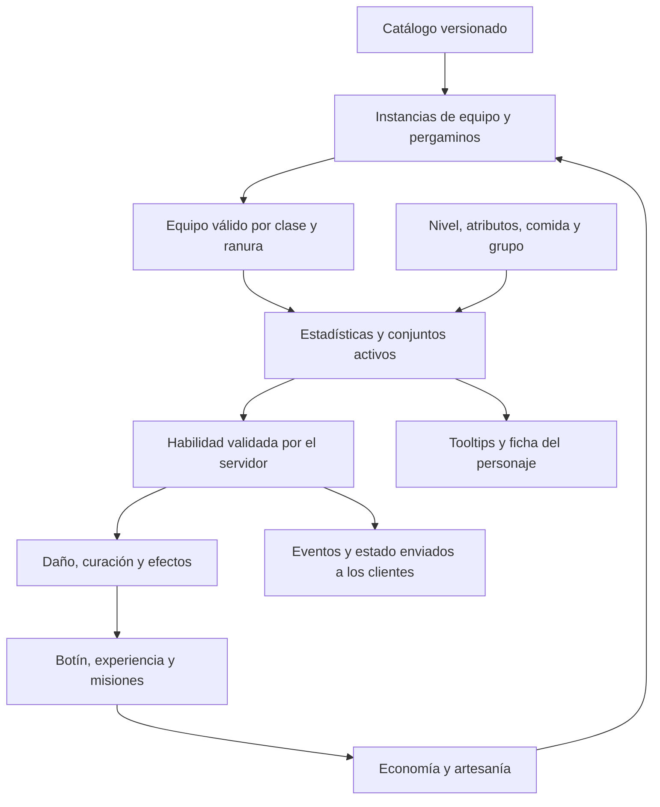

# Armas, encantamientos y conjuntos: diseño con el jugador

Estado: diseño en curso. Este documento distingue decisiones acordadas, propuestas y funcionamiento actual. Una propuesta no concede efectos en el juego ni debe aparecer como activa en un tooltip.

## Decisiones acordadas

| Decisión | Acuerdo |
| --- | --- |
| Papel del arma | Mejora estadísticas y añade efectos pequeños. Mantiene una rotación similar y las habilidades de clase. |
| Estadísticas base | Fijas por modelo. Dos copias del mismo modelo tienen las mismas cifras antes de encantarse. |
| Diferencias entre modelos | Jugables: pueden variar potencia, cadencia y alcance con compensaciones, conservando una rotación similar. |
| Roles de combate | Enfoque híbrido: todas las clases pueden aventurarse solas; las mazmorras difíciles se diseñan para tanque, sanador y daño. |
| Obtención de equipo | Artesanía y mazmorras ofrecen equipo de potencia comparable, con modelos y repartos diferentes. |
| Importancia de profesiones | Fundamental: habrá objetos excelentes que solo se puedan fabricar. La exclusividad de artesanía incluye equipo útil, no solo apariencias. |
| Dominio de oficios | Cada personaje puede dominar todos los oficios, sin un límite de profesiones dominadas. Dominar cada uno requiere una inversión importante e independiente. |
| Comercio de materiales | Todos los materiales de profesiones, incluidos los raros, pueden comprarse y venderse entre jugadores. No se exige obtenerlos personalmente para fabricar. |
| Vínculo del equipo fabricado | Ligado al equipar: puede venderse o regalarse hasta que se equipe por primera vez; entonces queda ligado a ese personaje. No se aplica esta decisión automáticamente a materiales, consumibles, muebles o botín de mazmorra. |
| Aprendizaje de recetas | Permanente por personaje: maestros enseñan recetas básicas; exploración, enemigos y mazmorras proporcionan especiales; proyectos de maestría desbloquean avanzadas del oficio. Las recetas encontradas pueden venderse antes de aprenderlas; aprenderlas consume su pergamino. Esto no convierte automáticamente las recetas de maestro o maestría en objetos comerciables. |
| Estaciones y fabricación | Se fabrica mediante estaciones del mundo y estaciones colocables en casas. Los talleres no se mejoran. Comida y pociones se fabrican instantáneamente, sin espera ni cola temporal. Para las recetas con tiempo se pueden encolar unidades y alejarse; avanzan también sin conexión y el resultado queda guardado para recogerlo, sin caducar. Los tiempos aumentan con la calidad del objeto; los proyectos de maestría incluyen componentes y pasos. Duraciones y capacidad de colas quedan por concretar; no dependen de mejoras de taller. |
| Colas de fabricación | Una cola por oficio y personaje, independiente de la estación utilizada, con un trabajo activo y pendientes que empiezan automáticamente. Distintos oficios pueden trabajar simultáneamente. Usar varias estaciones no multiplica los trabajos activos. Comida y pociones quedan fuera de las colas temporales. |
| Materiales y cancelación | Se reservan los materiales al encolar. Cancelar un trabajo pendiente o iniciado devuelve todos sus materiales; si estaba iniciado, pierde el progreso. Recoger el resultado anterior no bloquea el siguiente trabajo. |
| Consulta y recogida | La cola personal y los resultados terminados están disponibles en cualquier estación del mismo oficio, pública o de casa; no se exige volver a la estación donde se inició el trabajo. |
| Tiempos de equipo por pieza | Gris: 30 segundos; verde: 2 minutos; azul: 30 minutos; morado: 2 horas; dorado: 24 horas; naranja especial: 48 horas. Tiempos base, antes de la reducción racial humana del 15 %. |
| Tiempos de muebles y encantamientos | Serán más extensos que la escala de equipo; tablas y criterios concretos pendientes. Los tiempos de Encantamiento corresponden a fabricar pergaminos, sin añadir una espera nueva a su aplicación. Comida y pociones siguen siendo instantáneas. |
| Tiempo de muebles | Se combina calidad, tamaño y complejidad: una silla sencilla tarda menos que una gran biblioteca de la misma calidad. Duraciones y fórmula concretas pendientes. |
| Oficios iniciales | Herrería, Peletería (nuevo nombre de Marroquinería), Sastrería, Carpintería, Ebanistería (muebles), Joyería, Alquimia, Encantamiento y Cocina. Recolección inicial: Minero, Leñador y Recolector. Recolector obtiene plantas, hongos, fibras, frutas, bayas y otros ingredientes silvestres similares. |
| Progresión de oficios | Experiencia al fabricar recetas de dificultad adecuada; las demasiado fáciles dejan de dar experiencia, pero siguen siendo fabricables. Se aprenden recetas mediante maestros, exploración y comercio. Umbrales de experiencia y proyectos concretos pendientes. |
| Rangos de fabricación | Aprendiz: gris; Iniciado: verde; Oficial: azul; Experto: morado; Maestro: dorado; Gran maestro: naranja especial. El rango permite aprender las recetas correspondientes, no las concede automáticamente ni sustituye sus materiales. Acceder a Experto, Maestro y Gran maestro requiere proyectos de maestría de dificultad creciente. |
| Progresión de recolección | Minero, Leñador y Recolector usan los mismos seis rangos, ganan experiencia con recursos de dificultad adecuada y requieren pruebas de campo para los tres rangos superiores. Los recursos básicos siguen siendo ingredientes de recetas avanzadas. No hay bloqueo directo de recursos por rango: la dificultad se expresa mediante el coste de energía según dominio y recurso. Un principiante puede extraer un recurso de Experto a un coste poco rentable, pero no uno de nivel máximo por falta de capacidad energética. Fórmula, capacidad y recuperación pendientes. |
| Energía de recolección | Una reserva compartida entre Minero, Leñador y Recolector, independiente del recurso de combate. Se regenera con el tiempo, también sin conexión, hasta su capacidad máxima. En el futuro se podrá recargar con Lágrimas de fénix, sin superar ni aumentar su capacidad máxima y sin aumentar el dominio del oficio. Capacidad, velocidad de recuperación, cantidades, precios y límites de compra quedan por concretar. |
| Autonomía de recolección | Objetivo aprobado: una reserva llena permite aproximadamente 45–60 minutos de recolección habitual de recursos adecuados al dominio; recursos difíciles la consumen mucho más rápido. Es un objetivo de ritmo, no un límite de sesión ni una capacidad numérica implementada. Ajustar costes y reserva considerando la regeneración durante el juego. |
| Escala de energía | Escala inicial confirmada: reserva máxima de 100 puntos. Coste según diferencia de rangos recurso menos oficio: 0 o inferior = 1; +1 = 2,5; +2 = 8; +3 = 25; +4 = 70; +5 = 120 (supera la reserva). Cada oficio usa su propio dominio aunque comparta energía con los demás. Tiempos de extracción y cantidades obtenidas pendientes. Conservar los decimales para no alterar las proporciones. |
| Experiencia de recolección | Solo al completar la extracción. Recursos del propio rango conceden experiencia normal; superiores conceden algo más, con un límite; inferiores conceden menos, hasta dejar de dar experiencia cuando sean demasiado fáciles. Cantidades, límite del bono y umbral de dificultad trivial pendientes. |
| Extracción y gasto de energía | Mostrar el coste antes de empezar y exigir energía suficiente. Descontar energía solo al completar y obtener el recurso. Cancelar, alejarse o sufrir una interrupción antes de completar no consume energía ni concede materiales o experiencia. |
| Disponibilidad de recursos | Individual por personaje: cada uno puede recolectar una vez el mismo nodo antes de su recuperación individual. La extracción de otro jugador no lo agota para los demás ni interrumpe su extracción. Ubicación, recuperación y energía regulan la disponibilidad; tiempos concretos pendientes. |
| Herramientas de recolección | Pico para Minero, hacha de tala para Leñador y hoz para Recolector. Uso automático desde equipamiento de herramientas sin sustituir el arma de combate. Tienen desgaste y necesitan reparaciones; mayor dominio del oficio y calidad de herramienta reducen la frecuencia necesaria de reparación. A 0 de durabilidad quedan inutilizables hasta repararlas, sin destruirse ni perder calidad. Se reparan en un taller pagando Pelines. Fórmula, ranuras concretas, precios y talleres habilitados pendientes. |
| Desgaste de herramientas | Solo al completar una extracción; cancelar o sufrir una interrupción no desgasta. Recursos más difíciles desgastan más; el dominio del oficio y la calidad de herramienta reducen el desgaste. Fórmula y valores pendientes. |
| Obtención de herramientas | Herrería fabrica picos, hachas de tala y hoces de distintas calidades. Las básicas también se compran a comerciantes; las avanzadas son exclusivas de artesanía. Modelos, recetas, precios y corte entre básicas y avanzadas pendientes. |
| Calidad y uso de herramientas | Cualquier personaje puede usar herramientas de cualquier calidad sin exigir rango del oficio. La calidad reduce el desgaste, no el coste energético; no sustituye el dominio del oficio. Reducción frente a gris: gris 0 %, verde 4 %, azul 8 %, morado 12 %, dorado 16 %, naranja 20 %. Son reducciones totales por calidad. |
| Desgaste por dominio | Aprobado: Aprendiz 0 %, Iniciado 3 %, Oficial 6 %, Experto 9 %, Maestro 12 % y Gran maestro 15 %. Fórmula: desgaste base por dificultad × (1 − reducción por dominio) × (1 − reducción por calidad). Gran maestro con naranja sufre un 32 % menos de desgaste que el base. Desgaste base por dificultad pendiente. |
| Deterioro por reparación | Cada reparación normal reduce la durabilidad máxima; mayor dominio del oficio y calidad de herramienta reducen esa pérdida y prolongan su vida útil. Al agotarse su capacidad de reparación deja de poder repararse normalmente, sin borrarse. Esta decisión revisa la reparación anterior sin deterioro: la calidad/rareza del modelo no cambia, pero sí su máximo de durabilidad. Autonomía base aprobada: cuatro reservas de energía hasta la primera reparación para gris/Aprendiz con recursos de su rango. Las reparaciones posteriores reducen esa autonomía por la pérdida del máximo. |
| Restauración completa de herramientas | Se puede recuperar toda la durabilidad original mediante Lágrimas de fénix o un objeto muy raro. Debe recuperar tanto el máximo original como la durabilidad actual. Precio, objeto, procedencia y condiciones de uso pendientes; no se consume ni elimina automáticamente la herramienta deteriorada. |
| Pérdida máxima por reparación normal | Fórmula aprobada: pérdida = durabilidad máxima original × 0,05 × (1 − reducción por dominio) × (1 − reducción por calidad). Se usan los mismos porcentajes aprobados para desgaste de extracción: dominio 0/3/6/9/12/15 % y calidad 0/4/8/12/16/20 %. Gran maestro con naranja pierde un 3,4 % del máximo original por reparación; Aprendiz con gris pierde un 5 %. No se calcula sobre el máximo ya deteriorado. |
| Límite de reparación normal | Una reparación no puede dejar la durabilidad máxima por debajo del 20 % original. Si lo hiciera, se rechaza sin cobrar ni alterar la herramienta; necesita restauración completa o sustitución. Exactamente el 20 % sí es admisible. La durabilidad actual puede caer por debajo de ese porcentaje durante el uso, hasta 0; el límite afecta al máximo tras reparar. |
| Reparación parcial | Coste y pérdida de máximo proporcionales a la fracción de desgaste reparada. La pérdida base del 5 % corresponde a reparar desde 0; reparar antes de agotarse no aplica esa penalización completa. Fracción = (máximo vigente − durabilidad actual) / máximo vigente, antes de reparar. Multiplicar por esa fracción la pérdida completa calculada con dominio y calidad; rellenar hasta el nuevo máximo resultante. Aplicar el umbral del 20 % sobre ese resultado antes de cobrar. Precio base y redondeo monetario pendientes; a durabilidad llena no hay reparación ni cobro. |
| Ritmo de recuperación | Recuperación continua, también sin conexión: de vacío a lleno en 4 horas y 36 minutos. Se interpreta la corrección «15 % más lenta» como aumentar un 15 % la duración propuesta de 4 horas: 240 × 1,15 = 276 minutos. Capacidad y costes por extracción pendientes. |
| Afinidades raciales de oficios | Los humanos reducen un 15 % el tiempo de todas las recetas con duración, incluidos equipo, muebles y pergaminos: duración base × 0,85. Comida y pociones siguen siendo instantáneas. Para los elfos, la reducción de tiempo en Alquimia se sustituye por una habilidad racial: 25 % de probabilidad de fabricar una poción adicional del mismo modelo, sin materiales adicionales. Una tirada independiente por ejecución de receta, también en lotes; la unidad extra no activa nuevas tiradas. Se prevé ampliar las habilidades raciales a las demás razas en el futuro. Reglas de experiencia pendientes. |
| Personalización | Encantamiento elegido por el jugador. |
| Catálogo de encantamientos | Universal: compartido por todas las clases, sin encantamientos exclusivos de clase. |
| Límite de encantamientos | Un encantamiento activo por arma. Un nuevo pergamino sustituye el anterior. |
| Rareza mínima para encantar | Verde (poco común, categoría 1) y superiores. El equipo gris de categoría 0 no admite encantamientos. |
| Aplicación | Pergamino consumible, aplicación garantizada; sustituir un encantamiento elimina el anterior. |
| Funcionamiento de encantamientos | Modifican el arma y sus golpes; no dependen de usar habilidades. Esta decisión sustituye la activación mediante habilidades propuesta anteriormente. |
| Equipo inicial | Categoría 0; la siguiente es categoría 1. |
| Piezas de armadura | Cabeza, pecho, manos y piernas. Piernas incluye todo el calzado; no hay ranura separada de pies. |
| Bonificaciones de conjunto | 2/4 concede una mejora pequeña de estadísticas acorde al conjunto; 4/4 añade un efecto propio que refuerza una habilidad o función de clase sin cambiar toda la rotación. Combinar dos conjuntos de dos piezas concede ambos bonos parciales. Efectos concretos y cifras pendientes; no están implementados. |
| Atributo principal | Fuerza: guerrero. Agilidad: pícaro y explorador. Intelecto: mago y clérigo. Corpulencia: supervivencia. |
| Colores actuales | Gris, verde, azul, morado, dorado, naranja especial. |

Pendiente: compatibilidad con armas secundarias, fabricación y obtención de pergaminos, costes, estadísticas secundarias, fórmulas de los atributos, efectos de conjuntos y cifras de equilibrio. La aplicación garantizada no determina por sí sola las reglas de fabricación.

## Lo que existe hoy

- 88 armas, cinco clases y una habilidad activa por clase, con cinco rangos.
- Arma principal: `power`; varita: además `healing`. Escudo y daga secundaria: `guard`. Libro: `healing`.
- El ataque básico crece con el nivel. El cálculo de las habilidades usa otra fórmula que actualmente no aplica ese mismo crecimiento.
- Alcance y cadencia dependen de la clase, no del modelo de arma.
- 55 conjuntos visuales, cada uno con cuatro piezas de armadura independientes; 33 accesorios. Las piernas incluyen pantalones, rodilleras cuando correspondan y botas.
- Las piezas suman guardia, vida o recurso. No hay bonificaciones por completar conjunto.
- Inventario: identificador de catálogo, cantidad y vínculo. No distingue dos copias encantadas de un modelo.
- No hay encantamientos ni un motor general de efectos persistentes implementados.

Fuentes: `src/data/weapons.ts`, `combat.ts`, `outfits.ts`, `accessories.ts`, `inventory.ts`; `supabase/server/05-weapon-stats.sql` y `07-combat.sql`.

## Paso siguiente: atributos comprensibles

Propuesta pendiente de acordar:

1. Conservar potencia de ataque, potencia de curación y guardia como propiedades principales. El escudo y el libro deben tener una aportación visible propia; la daga secundaria necesita revisar su identidad, porque hoy únicamente reduce daño recibido.
2. Conectar primero los atributos de personaje a sus efectos reales. Está acordado usar fuerza para el guerrero, agilidad para pícaro/explorador, intelecto para mago/clérigo y corpulencia para supervivencia. Todavía no están aprobadas ni implementadas las fórmulas nuevas de potencia: elegir el reparto no cambia por sí solo el daño actual.
3. Empezar con pocas estadísticas secundarias y límites comunes: vida, recurso y eficiencia de habilidades son candidatas. Crítico, celeridad, resistencias y penetración requieren reglas propias antes de introducirse.
4. Cada modelo puede tener un reparto fijo distinto, con un presupuesto comparable a otros de su escalón. Evitar que una opción gane en todas las cifras sin contrapartida dentro del mismo escalón.
5. Pericia, presencia y percepción necesitan sistemas de oficio, comercio y exploración. No llenar el botín de armas con estadísticas que aún no tengan utilidad.

### Perfiles de arma: diferencias jugables aprobadas

La decisión permite diferencias entre modelos de una misma familia, sin transformar las habilidades de clase. Propuesta inicial de perfiles, aún sin asignación ni cifras definitivas:

| Perfil | Ventaja | Compensación y utilidad |
| --- | --- | --- |
| Ligero | Intervalos cortos; cómodo para aprovechar ventanas pequeñas | Menos daño por golpe; alcance más corto cuando encaje con el modelo |
| Versátil | Valores intermedios | Menor especialización; opción de referencia para comparar |
| Pesado | Golpes potentes y alcance algo mayor cuando la geometría lo justifique | Intervalos largos; perder una oportunidad de atacar cuesta más |

Comparar armas del mismo escalón por daño sostenido, daño en ventanas cortas, alcance, supervivencia y rendimiento de sus encantamientos. No basta con igualar daño por segundo contra un objetivo inmóvil. Evitar que el pesado obtenga además habilidades mucho más fuertes solo por tener más daño por golpe: la potencia de las habilidades debe normalizarse respecto a la cadencia de referencia de la clase. Es una regla de equilibrio propuesta, pendiente de fórmula.

Vampirismo y Maldición umbría pueden presupuestarse proporcionalmente al daño del arma; un añadido fijo por golpe favorecería la cadencia rápida. Escarcha necesita límites de duración/renovación para impedir ralentización permanente. La defensa plana por impacto también puede perjudicar más a las armas rápidas: revisar esa interacción al introducir defensa en enemigos.

El alcance visible, la distancia validada por servidor, el movimiento de aproximación y el tooltip deben leer el mismo valor por arma. La cadencia debe coordinar animación, reloj de ataque y resolución del servidor. Actualmente estos valores siguen definidos por clase: aprobar los perfiles no los implementa automáticamente.

### Cálculo común propuesto

Propuesta: obtener primero una potencia efectiva a partir del arma, nivel y atributos. Tanto ataque básico como habilidades deben usar esa base; la habilidad añade su coeficiente y rango. Curación, guardia y supervivencia necesitan sus propias fórmulas explícitas.

Definir antes de equilibrar: orden de sumas y porcentajes, redondeo, mínimos y máximos, alcance, cadencia, coste y recarga. Aplicar los mismos límites a objetos, comida, grupos y conjuntos. No elegir porcentajes aislados sin considerar la suma del equipo completo.

La rareza y el nivel de poder son conceptos distintos aunque el catálogo actual los vincule. Hay que decidir si seguirán unidos. No mostrar el número interno de categoría como si fuera un requisito de nivel.

## Encantamientos: propuesta inicial

Está acordado un encantamiento activo por arma. No se acumulan dos encantamientos en el mismo objeto: aplicar otro sustituye el anterior. La fuerza del pergamino debe tener requisitos de equipo para evitar equipar un efecto avanzado en el arma inicial y saltarse la progresión.

La compatibilidad con secundarias queda por concretar. Si escudo, libro y daga secundaria admiten efectos, hay que equilibrar la aportación total frente a las clases con una sola arma. Cada efecto pertenece al objeto encantado y no se aplica automáticamente a los golpes de otra arma.

Contrato de un encantamiento:

- Identidad y versión; nombre y descripción.
- Armas o ranuras compatibles y requisitos.
- Valor y duración explícitos, límite de acumulación y regla de renovación.
- Modificación de una propiedad del arma o activación al impactar con ella. Las habilidades no disparan sus efectos. La regla exacta por golpe, contador o probabilidad queda por decidir.
- Coste y fuente de obtención del pergamino, todavía por decidir.
- Aplicación garantizada, consumo del pergamino y sustitución del anterior: **acordado**.

El catálogo será universal por decisión del usuario. Los anteriores ejemplos exclusivos por clase se sustituyen por propuestas comunes. Universal significa compartido entre clases. La rareza mínima aprobada es verde (categoría 1); la compatibilidad con ranuras sigue pendiente. La restricción se validará tanto al mostrar destinos elegibles como al aplicar el pergamino en el servidor.

Primeros ejemplos para discutir, sin cifras ni efectos activos todavía:

| Encantamiento propuesto | Efecto común | Restricción de diseño |
| --- | --- | --- |
| Filo ígneo | Los impactos del arma añaden una pequeña cantidad de daño de fuego | Fijar presupuesto por segundo y relación con la cadencia |
| Vampirismo | Recupera una parte del daño que inflige esa arma | Usar daño efectivo; no curar por daño absorbido, excedente o generado por el propio encantamiento |
| Escarcha | Los impactos del arma pueden ralentizar al objetivo | Duración y magnitud pendientes; limitar renovación y resistencia de enemigos especiales |
| Maldición umbría | Tres impactos del arma sobre el mismo enemigo consumen las marcas y causan daño oscuro adicional | Contador propio del portador, arma y objetivo; sin activación por habilidades |

### Maldición umbría: sustituto de Equilibrio

El usuario ha pedido sustituir Equilibrio por un encantamiento de daño oscuro. Propuesta concreta inicial, todavía sin implementación de combate:

- Cada ataque básico que impacta y causa daño con el arma encantada aplica una marca umbría a ese enemigo.
- El tercer impacto consume las marcas y añade una descarga de daño oscuro al golpe normal. No necesita habilidades ni una tirada aleatoria.
- Valor inicial propuesto: daño oscuro equivalente al 30 % del daño de un ataque básico de esa arma, antes de defensas. Supone aproximadamente un 10 % adicional a lo largo de tres golpes contra un objetivo sin mitigación. La cifra queda pendiente de equilibrio junto a los demás encantamientos.
- Las marcas caducan tras 6 segundos sin otro impacto válido de esa misma arma. Son propias de cada combinación de portador, instancia de arma y enemigo; otros jugadores no las consumen.
- Retirar o sustituir el arma o su encantamiento, morir o salir del encuentro elimina sus marcas. El daño de la descarga no aplica nuevas marcas ni activa otros encantamientos.
- Texto de tooltip propuesto: «Tus golpes aplican marcas umbrías. Cada tercer impacto sobre el mismo enemigo consume las marcas y causa daño oscuro adicional. Las marcas desaparecen tras 6 s sin golpearlo»; al implementar, incluir también el valor efectivo de la descarga.

Estos son candidatos, no efectos ya acordados. Los ataques básicos del bastón y la varita también son golpes de arma. La curación del clérigo no activa encantamientos por ser una habilidad. Hace falta equilibrar la aportación por segundo entre armas rápidas y lentas; compartir el catálogo no garantiza por sí solo igualdad de potencia.

Los pergaminos pueden tener variantes numéricas o de utilidad sin sustituir la habilidad por otra. Debe haber opciones útiles con más de un conjunto. El usuario ha elegido mantener una rotación similar: estos ejemplos no añaden botones ni una rotación obligatoria nueva.

### Reglas que hay que resolver antes de programar efectos

- Identificar cada impacto del arma y su origen. Una habilidad, aunque visualmente use el arma, no dispara el encantamiento.
- Un daño periódico o un efecto generado no vuelve a disparar encantamientos por defecto.
- Duración y recargas se miden en tiempo del servidor. Reconectar no reinicia ni concede activaciones.
- Definir si los efectos acumulan intensidad, duración, se renuevan o se sustituyen; nunca dejarlo implícito.
- Resolver retirada del arma, cambio de mapa, muerte, objetivo muerto, desconexión y cambio de conjunto.
- Distinguir daño, curación, absorción y sobrecuración. No presentarlos como equivalentes.
- El disparador consume recursos y genera efectos una sola vez, aunque se reenvíe una solicitud.

## Conjuntos: estructura acordada, efectos pendientes

Acuerdo: cuatro piezas de armadura —cabeza, pecho, manos y piernas con calzado— y bonificaciones con 2/4 y 4/4. Se cuentan piezas de la misma colección y clase. Arma, secundaria y joyas quedan libres para personalización. Así las clases con una o dos piezas de arma tienen el mismo requisito para completar un conjunto.

La unión de piernas y botas está implementada en catálogo, montaje y GLB modular. La migración `17-combined-legwear.sql` conserva las piezas antiguas: cada bota se convierte en unas piernas completas. Si la ranura de piernas estaba ocupada, la conversión vuelve a mochila/banco o queda en la cola de entrega. Es una compensación de una sola vez que conserva cada objeto adquirido.

Estructura de contenido aprobada: un bono pequeño de estadísticas acorde al conjunto con 2/4 y un efecto propio con 4/4 que refuerce una habilidad o función de clase, sin obligar a cambiar toda la rotación. Dos piezas de un conjunto y dos de otro conceden ambos bonos parciales; completar cuatro concede su bono de 2/4 y el de 4/4. Las orientaciones aprobadas por clase se detallan a continuación; sus cifras y reglas específicas siguen pendientes de implementación y equilibrio. No confundir los efectos de conjunto con encantamientos de arma: estos siguen vinculados al arma y sus golpes básicos, sin activarse mediante habilidades.

### Orientaciones del guerrero aprobadas

Se diseñan para los conjuntos existentes, sin sustituir ni eliminar sus modelos:

| Orientación | 2 piezas | 4 piezas |
| --- | --- | --- |
| Defensiva | Más guardia. | Usar la habilidad concede una protección breve. |
| Ofensiva | Más potencia de ataque. | Usar la habilidad potencia el siguiente ataque básico. |

Ambas permiten jugar en solitario; la defensiva favorece el papel de tanque. Estas orientaciones y efectos generales están aprobados, pero quedan pendientes la asignación a conjuntos concretos, cifras, duraciones, tipo de protección, caducidad de la mejora ofensiva y reglas de acumulación. Todavía no están implementados. El efecto ofensivo es de conjunto, no una modificación de los encantamientos.

### Orientaciones del pícaro

- **Ofensiva aprobada:** 2 piezas aumentan la potencia de ataque; 4 piezas hacen que la habilidad aumente brevemente el daño contra el objetivo golpeado. Valores, duración, alcance del aumento de daño y acumulación pendientes; no implementado.
- **Escurridiza descartada en su forma propuesta:** no se aprueba el bono de velocidad de movimiento tras usar la habilidad. El usuario pide rediseñarla.
- **Duelista aprobada:** 2 piezas aumentan modestamente la guardia; con 4, acertar Corte doble reduce el daño del siguiente golpe recibido durante una ventana breve. Consumir la preparación al recibir ese golpe, sin inmunidad ni acumulación. Magnitud de la reducción, duración, definición del golpe elegible y asignación a conjuntos pendientes; no implementado. Se apoya en Corte doble, habilidad actual del pícaro en `src/data/combat.ts`.

### Orientaciones del mago aprobadas

- **Evocador:** 2 piezas aumentan la potencia mágica; con 4, acertar Descarga arcana provoca un pequeño eco de daño posterior en el mismo enemigo. El eco no se repite ni activa encantamientos. Daño y retraso del eco pendientes.
- **Arcanista de área:** 2 piezas aumentan el maná máximo; con 4, Descarga arcana conserva su impacto principal y añade una explosión pequeña alrededor del objetivo, con daño reducido a enemigos cercanos y sin añadir un segundo impacto al objetivo principal. Sustituye la propuesta de Canalizador con devolución de maná. El daño secundario no genera nuevas explosiones ni activa encantamientos. Radio, límite de objetivos y cifras pendientes.

Ambas orientaciones y sus efectos generales quedan aprobados; conservan la rotación y favorecen respectivamente un objetivo o grupos. Asignación a conjuntos, magnitudes y reglas detalladas pendientes; no implementadas.

### Orientaciones del explorador

El usuario pide dos alternativas enteramente nuevas: se retiran Tirador (daño según distancia), Cazador (ralentización) y Acechador (sangrado). La aprobación anterior de Tirador queda revocada por esta última instrucción.

Estado de las alternativas revisadas:

- **Hostigador descartado:** el usuario pide sustituir la propuesta de acelerar dos ataques básicos tras Disparo preciso.
- **Quebrantador aprobado:** 2 piezas aumentan la potencia de ataque; con 4, Disparo preciso ignora una pequeña parte de la guardia del objetivo al calcular ese impacto. No reduce la defensa para otros ataques ni otros jugadores; no ignora toda la defensa. Porcentaje y relación con fórmulas defensivas pendientes.
- **Tiro de barrido aprobado:** 2 piezas aumentan el recurso máximo; con 4, Disparo preciso atraviesa al objetivo y puede golpear hasta dos enemigos situados detrás, en una franja estrecha, con daño reducido. No duplica impactos sobre un mismo enemigo ni activa encantamientos con los impactos secundarios. Posicionarse para alinear enemigos diferencia esta opción de una explosión de área. Anchura, alcance posterior, daño y validación de obstáculos pendientes.

Son efectos de conjunto, no encantamientos ni habilidades nuevas. Quebrantador y Tiro de barrido están aprobados en su funcionamiento general. Valores y asignación a conjuntos pendientes; no implementados.

### Orientaciones del clérigo aprobadas

El usuario pide otra propuesta tras presentar Sanador con curación periódica y Clérigo de batalla con ataque potenciado tras Curación. Ninguna de esas opciones queda aprobada.

Alternativas aprobadas:

- **Custodio:** 2 piezas aumentan la potencia de curación; con 4, Curación concede además un pequeño escudo temporal al objetivo curado, incluido el propio clérigo. Sin acumulación de escudos del mismo efecto.
- **Restaurador:** 2 piezas aumentan el maná máximo; con 4, Curación conserva su efecto principal y cura en menor cantidad a aliados cercanos al objetivo, sin curar dos veces al objetivo principal ni encadenar curaciones secundarias.

Ambas funcionan también al curarse el propio clérigo. Cifras, radio, límite de objetivos, duración del escudo, convivencia entre clérigos y asignación a conjuntos pendientes. Requiere diseñar selección y validación de aliados y curación cooperativa: la Curación actual en `src/data/combat.ts` se aplica al propio personaje y no acredita un sistema de sanación de grupo implementado. Los nuevos efectos de conjunto están aprobados como diseño, todavía no implementados.

Reglas propuestas:

- Contar ranuras válidas, no cantidad del objeto ni copias en la mochila.
- Contar cada pieza una sola vez y comprobar clase y ranura.
- La colección visual no implica automáticamente un conjunto mecánico; hace falta una definición explícita de bonificaciones.
- Mostrar piezas equipadas y umbrales activos/inactivos, con requisitos exactos.
- Comparar conjunto completo contra combinaciones de piezas. El bono completo debe ser atractivo sin invalidar todo equipo suelto.
- Cambiar piezas no cura ni rellena recurso, no reinicia recargas y no conserva cargas que permitan abusar del cambio.
- Arma, encantamiento y conjunto comparten un presupuesto de potencia; los tres no multiplican indiscriminadamente el daño.

## Sincronía entre sistemas

### Identidad del objeto y transacciones

Antes de aplicar un encantamiento real, añadir una identidad de instancia al equipo no apilable. Modelo conceptual: `instanceId`, `definitionId`, `enchantmentId`, `revision` y propietario. El catálogo conserva los valores base fijos.

Hay que migrar y adaptar conjuntamente: normalización de personaje, inventario, equipo, banco, comercio, botín, persistencia y apariencia remota. El normalizador actual descarta metadatos extra: añadir solo un campo al tooltip o al cliente perdería el encantamiento al guardar.

Aplicación en servidor: validar sesión, propiedad, compatibilidad y revisiones; consumir pergamino y recursos; sustituir encantamiento; recalcular estadísticas; invalidar ofertas de comercio afectadas; confirmar toda la operación de forma atómica. Identificar reintentos para no cobrar dos veces. No enviar al servidor un valor de bonificación calculado por el cliente.

### Una definición, varios consumidores

La definición de objetos y efectos debe alimentar catálogo del servidor, cálculos del cliente, tooltips, ficha y herramienta de equilibrio. Mantener `catalogVersion` y una revisión del estado evita que una respuesta antigua vuelva a equipar un objeto ya sustituido.

Actualmente el catálogo de equipo ya se genera para SQL con `tools/build-weapon-catalog.mjs`, pero varias reglas de combate siguen escritas por separado en TypeScript y SQL. Ampliar la generación y registrar qué versión usa cada cliente antes de añadir más fórmulas duplicadas.

## Tooltips: primera pasada aplicada

- Nombre, rareza y tipo; clase y ranura; colección visual.
- Estadísticas reales, alcance e intervalo del ataque básico para armas principales.
- Descripción breve de construcción y acabado, diferenciada por familia, pieza y colección.
- Vínculo y venta separados de los efectos de combate.
- Sin instrucciones repetidas para equipar, sin repetir la rareza en otra fila y sin categoría numérica ambigua.
- No mostrar encantamientos ni bonificaciones inexistentes como activos.

Cuando se implementen: añadir nivel/requisitos reales, encantamiento aplicado y valores exactos, progreso del conjunto y comparación contextual con lo equipado. Los valores efectivos deben usar la misma fórmula que el combate, distinguiéndolos de valores base. Preservar traducción y navegación accesible.

## Orden de trabajo acordable

1. Decidir estilo de armas, variación base y sustitución de encantamientos: **acordado**.
2. Atributos principales y umbrales 2/4–4/4: **acordados**. Decidir estadísticas secundarias, fórmulas, efectos de conjunto y primer catálogo pequeño de pergaminos.
3. Cerrar fórmulas comunes y presupuesto de potencia; revisar el daño de habilidades frente al básico.
4. Preparar instancias y migración de todas las vías de inventario.
5. Implementar el motor de efectos y una versión jugable de una familia completa, con tooltip fiel al servidor.
6. Extender a las demás clases, obtención de pergaminos, artesanía y recompensas.

No convertir esta hoja en un plan para implementar todos los sistemas MMORPG a la vez. La revisión de dependencias está en [MMORPG-SYSTEMS-REVIEW.md](MMORPG-SYSTEMS-REVIEW.md).
