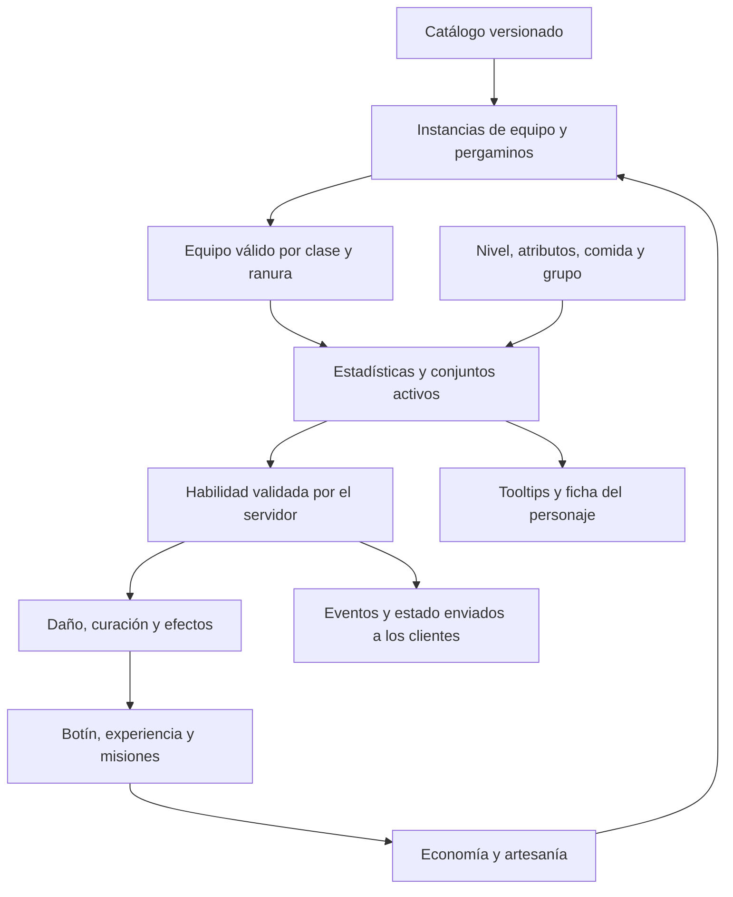

# Armas, encantamientos y conjuntos: diseño con el jugador

Estado: diseño con historial de decisiones. La implementación del 24 de octubre está descrita en [RPG-IMPLEMENTATION.md](RPG-IMPLEMENTATION.md), con fórmulas, acceso en el juego y pendientes. Las referencias a «todavía no implementado» en secciones anteriores describen el estado al redactar esas decisiones. Para conjuntos prevalece la última corrección: bonificaciones numéricas, sin transformar habilidades; los efectos anteriores están archivados en [SET-EFFECTS-SUPERSEDED.md](SET-EFFECTS-SUPERSEDED.md).

## Decisiones acordadas

| Decisión | Acuerdo |
| --- | --- |
| Papel del arma | Mejora estadísticas y añade efectos pequeños. Mantiene una rotación similar y las habilidades de clase. |
| Estadísticas base | Fijas por modelo. Dos copias del mismo modelo tienen las mismas cifras antes de encantarse. |
| Diferencias entre modelos | Jugables: pueden variar potencia, cadencia y alcance con compensaciones, conservando una rotación similar. |
| Roles de combate | Enfoque híbrido: todas las clases pueden aventurarse solas; las mazmorras difíciles se diseñan para tanque, sanador y daño. |
| Obtención de equipo | Artesanía y mazmorras ofrecen equipo de potencia comparable, con modelos y repartos diferentes. |
| Importancia de profesiones | Fundamental: habrá objetos excelentes que solo se puedan fabricar. La exclusividad de artesanía incluye equipo útil, no solo apariencias. |
| Dominio de oficios | Cada personaje puede dominar todos los oficios, sin un límite de profesiones dominadas. Dominar cada uno requiere una inversión importante e independiente. |
| Comercio de materiales | Todos los materiales de profesiones, incluidos los raros, pueden comprarse y venderse entre jugadores. No se exige obtenerlos personalmente para fabricar. |
| Vínculo del equipo fabricado | Ligado al equipar: puede venderse o regalarse hasta que se equipe por primera vez; entonces queda ligado a ese personaje. No se aplica esta decisión automáticamente a materiales, consumibles, muebles o botín de mazmorra. |
| Aprendizaje de recetas | Permanente por personaje: maestros enseñan recetas básicas; exploración, enemigos y mazmorras proporcionan especiales; proyectos de maestría desbloquean avanzadas del oficio. Las recetas encontradas pueden venderse antes de aprenderlas; aprenderlas consume su pergamino. Esto no convierte automáticamente las recetas de maestro o maestría en objetos comerciables. |
| Estaciones y fabricación | Se fabrica mediante estaciones del mundo y estaciones colocables en casas. Los talleres no se mejoran. Comida y pociones se fabrican instantáneamente, sin espera ni cola temporal. Para las recetas con tiempo se pueden encolar unidades y alejarse; avanzan también sin conexión y el resultado queda guardado para recogerlo, sin caducar. Los tiempos aumentan con la calidad del objeto; los proyectos de maestría incluyen componentes y pasos. Duraciones y capacidad de colas quedan por concretar; no dependen de mejoras de taller. |
| Colas de fabricación | Una cola por oficio y personaje, independiente de la estación utilizada, con un trabajo activo y pendientes que empiezan automáticamente. Distintos oficios pueden trabajar simultáneamente. Usar varias estaciones no multiplica los trabajos activos. Comida y pociones quedan fuera de las colas temporales. |
| Capacidad y gestión de colas | Máximo cinco trabajos por oficio en total: uno activo y cuatro pendientes. Se concreta así «hasta 5 por oficio». Pendientes reordenables gratuitamente; resultados terminados no ocupan puestos ni bloquean el avance. Sin mejoras de taller ni ampliaciones premium de cola. Los materiales se reservan al encolar. |
| Garantías de fabricación | Cumplir receta, materiales y requisitos de oficio garantiza el resultado, sin fallos aleatorios. Estadísticas fijas por modelo. La experiencia se concede al terminar, una sola vez, aunque se recoja después. Resultados y materiales devueltos por cancelación permanecen pendientes de recoger si falta espacio, sin caducar ni perderse. Las pociones adicionales de la racial élfica no dan experiencia extra. |
| Materiales y cancelación | Se reservan los materiales al encolar. Cancelar un trabajo pendiente o iniciado devuelve todos sus materiales; si estaba iniciado, pierde el progreso. Recoger el resultado anterior no bloquea el siguiente trabajo. |
| Consulta y recogida | La cola personal y los resultados terminados están disponibles en cualquier estación del mismo oficio, pública o de casa; no se exige volver a la estación donde se inició el trabajo. |
| Tiempos de equipo por pieza | Gris: 30 segundos; verde: 2 minutos; azul: 30 minutos; morado: 2 horas; dorado: 24 horas; naranja especial: 48 horas. Tiempos base, antes de la reducción racial humana del 15 %. |
| Tiempos de muebles y encantamientos | Serán más extensos que la escala de equipo; tablas y criterios concretos pendientes. Los tiempos de Encantamiento corresponden a fabricar pergaminos, sin añadir una espera nueva a su aplicación. Comida y pociones siguen siendo instantáneas. |
| Tiempo de muebles | Se combina calidad, tamaño y complejidad: una silla sencilla tarda menos que una gran biblioteca de la misma calidad. Duraciones y fórmula concretas pendientes. |
| Oficios iniciales | Herrería, Peletería (nuevo nombre de Marroquinería), Sastrería, Carpintería, Ebanistería (muebles), Joyería, Alquimia, Encantamiento y Cocina. Recolección inicial: Minero, Leñador y Recolector. Recolector obtiene plantas, hongos, fibras, frutas, bayas y otros ingredientes silvestres similares. |
| Progresión de oficios | Experiencia al fabricar recetas de dificultad adecuada; las demasiado fáciles dejan de dar experiencia, pero siguen siendo fabricables. Se aprenden recetas mediante maestros, exploración y comercio. Umbrales de experiencia y proyectos concretos pendientes. |
| Rangos de fabricación | Aprendiz: gris; Iniciado: verde; Oficial: azul; Experto: morado; Maestro: dorado; Gran maestro: naranja especial. El rango permite aprender las recetas correspondientes, no las concede automáticamente ni sustituye sus materiales. Acceder a Experto, Maestro y Gran maestro requiere proyectos de maestría de dificultad creciente. |
| Progresión de recolección | Minero, Leñador y Recolector usan los mismos seis rangos, ganan experiencia con recursos de dificultad adecuada y requieren pruebas de campo para los tres rangos superiores. Los recursos básicos siguen siendo ingredientes de recetas avanzadas. No hay bloqueo directo de recursos por rango: la dificultad se expresa mediante el coste de energía según dominio y recurso. Un principiante puede extraer un recurso de Experto a un coste poco rentable, pero no uno de nivel máximo por falta de capacidad energética. Fórmula, capacidad y recuperación pendientes. |
| Energía de recolección | Una reserva compartida entre Minero, Leñador y Recolector, independiente del recurso de combate. Se regenera con el tiempo, también sin conexión, hasta su capacidad máxima. En el futuro se podrá recargar con Lágrimas de fénix, sin superar ni aumentar su capacidad máxima y sin aumentar el dominio del oficio. Capacidad, velocidad de recuperación, cantidades, precios y límites de compra quedan por concretar. |
| Autonomía de recolección | Objetivo aprobado: una reserva llena permite aproximadamente 45–60 minutos de recolección habitual de recursos adecuados al dominio; recursos difíciles la consumen mucho más rápido. Es un objetivo de ritmo, no un límite de sesión ni una capacidad numérica implementada. Ajustar costes y reserva considerando la regeneración durante el juego. |
| Escala de energía | Escala inicial confirmada: reserva máxima de 100 puntos. Coste según diferencia de rangos recurso menos oficio: 0 o inferior = 1; +1 = 2,5; +2 = 8; +3 = 25; +4 = 70; +5 = 120 (supera la reserva). Cada oficio usa su propio dominio aunque comparta energía con los demás. Tiempos de extracción y cantidades obtenidas pendientes. Conservar los decimales para no alterar las proporciones. |
| Experiencia de recolección | Solo al completar la extracción. Recursos del propio rango conceden experiencia normal; superiores conceden algo más, con un límite; inferiores conceden menos, hasta dejar de dar experiencia cuando sean demasiado fáciles. Cantidades, límite del bono y umbral de dificultad trivial pendientes. |
| Extracción y gasto de energía | Mostrar el coste antes de empezar y exigir energía suficiente. Descontar energía solo al completar y obtener el recurso. Cancelar, alejarse o sufrir una interrupción antes de completar no consume energía ni concede materiales o experiencia. |
| Disponibilidad de recursos | Individual por personaje: cada uno puede recolectar una vez el mismo nodo antes de su recuperación individual. La extracción de otro jugador no lo agota para los demás ni interrumpe su extracción. Ubicación, recuperación y energía regulan la disponibilidad; tiempos concretos pendientes. |
| Herramientas de recolección | Pico para Minero, hacha de tala para Leñador y hoz para Recolector. Uso automático desde equipamiento de herramientas sin sustituir el arma de combate. Tienen desgaste y necesitan reparaciones; mayor dominio del oficio y calidad de herramienta reducen la frecuencia necesaria de reparación. A 0 de durabilidad quedan inutilizables hasta repararlas, sin destruirse ni perder calidad. Se reparan en un taller pagando Pelines. Fórmula, ranuras concretas, precios y talleres habilitados pendientes. |
| Desgaste de herramientas | Solo al completar una extracción; cancelar o sufrir una interrupción no desgasta. Recursos más difíciles desgastan más; el dominio del oficio y la calidad de herramienta reducen el desgaste. Fórmula y valores pendientes. |
| Obtención de herramientas | Herrería fabrica picos, hachas de tala y hoces de distintas calidades. Las básicas también se compran a comerciantes; las avanzadas son exclusivas de artesanía. Modelos, recetas, precios y corte entre básicas y avanzadas pendientes. |
| Calidad y uso de herramientas | Cualquier personaje puede usar herramientas de cualquier calidad sin exigir rango del oficio. La calidad reduce el desgaste, no el coste energético; no sustituye el dominio del oficio. Reducción frente a gris: gris 0 %, verde 4 %, azul 8 %, morado 12 %, dorado 16 %, naranja 20 %. Son reducciones totales por calidad. |
| Desgaste por dominio | Aprobado: Aprendiz 0 %, Iniciado 3 %, Oficial 6 %, Experto 9 %, Maestro 12 % y Gran maestro 15 %. Fórmula: desgaste base por dificultad × (1 − reducción por dominio) × (1 − reducción por calidad). Gran maestro con naranja sufre un 32 % menos de desgaste que el base. Desgaste base por dificultad pendiente. |
| Deterioro por reparación | Cada reparación normal reduce la durabilidad máxima; mayor dominio del oficio y calidad de herramienta reducen esa pérdida y prolongan su vida útil. Al agotarse su capacidad de reparación deja de poder repararse normalmente, sin borrarse. Esta decisión revisa la reparación anterior sin deterioro: la calidad/rareza del modelo no cambia, pero sí su máximo de durabilidad. Autonomía base aprobada: cuatro reservas de energía hasta la primera reparación para gris/Aprendiz con recursos de su rango. Las reparaciones posteriores reducen esa autonomía por la pérdida del máximo. |
| Restauración completa de herramientas | Se puede recuperar toda la durabilidad original mediante Lágrimas de fénix o un objeto muy raro. Debe recuperar tanto el máximo original como la durabilidad actual. Precio, objeto, procedencia y condiciones de uso pendientes; no se consume ni elimina automáticamente la herramienta deteriorada. |
| Pérdida máxima por reparación normal | Fórmula aprobada: pérdida = durabilidad máxima original × 0,05 × (1 − reducción por dominio) × (1 − reducción por calidad). Se usan los mismos porcentajes aprobados para desgaste de extracción: dominio 0/3/6/9/12/15 % y calidad 0/4/8/12/16/20 %. Gran maestro con naranja pierde un 3,4 % del máximo original por reparación; Aprendiz con gris pierde un 5 %. No se calcula sobre el máximo ya deteriorado. |
| Límite de reparación normal | Una reparación no puede dejar la durabilidad máxima por debajo del 20 % original. Si lo hiciera, se rechaza sin cobrar ni alterar la herramienta; necesita restauración completa o sustitución. Exactamente el 20 % sí es admisible. La durabilidad actual puede caer por debajo de ese porcentaje durante el uso, hasta 0; el límite afecta al máximo tras reparar. |
| Reparación parcial | Coste y pérdida de máximo proporcionales a la fracción de desgaste reparada. La pérdida base del 5 % corresponde a reparar desde 0; reparar antes de agotarse no aplica esa penalización completa. Fracción = (máximo vigente − durabilidad actual) / máximo vigente, antes de reparar. Multiplicar por esa fracción la pérdida completa calculada con dominio y calidad; rellenar hasta el nuevo máximo resultante. Aplicar el umbral del 20 % sobre ese resultado antes de cobrar. Precio base y redondeo monetario pendientes; a durabilidad llena no hay reparación ni cobro. |
| Ritmo de recuperación | Recuperación continua, también sin conexión: de vacío a lleno en 4 horas y 36 minutos. Se interpreta la corrección «15 % más lenta» como aumentar un 15 % la duración propuesta de 4 horas: 240 × 1,15 = 276 minutos. Capacidad y costes por extracción pendientes. |
| Afinidades raciales de oficios | Los humanos reducen un 15 % el tiempo de todas las recetas con duración, incluidos equipo, muebles y pergaminos: duración base × 0,85. Comida y pociones siguen siendo instantáneas. Para los elfos, la reducción de tiempo en Alquimia se sustituye por una habilidad racial: 25 % de probabilidad de fabricar una poción adicional del mismo modelo, sin materiales adicionales. Una tirada independiente por ejecución de receta, también en lotes; la unidad extra no activa nuevas tiradas. Se prevé ampliar las habilidades raciales a las demás razas en el futuro. Reglas de experiencia pendientes. |
| Personalización | Encantamiento elegido por el jugador. |
| Catálogo de encantamientos | Universal: compartido por todas las clases, sin encantamientos exclusivos de clase. |
| Límite de encantamientos | Un encantamiento activo por arma. Un nuevo pergamino sustituye el anterior. |
| Piezas encantables en la primera versión | Solo el arma principal, desde verde. Escudos, libros y dagas secundarias conservan sus estadísticas pero no admiten otro encantamiento; todas las clases tienen un único encantamiento activo. Mejoras específicas para secundarias se estudiarán después. |
| Encantamiento y vínculo | Encantar no liga el arma: puede venderse o regalarse con el encantamiento hasta equiparla por primera vez según la regla de ligado al equipar. Cambiar el encantamiento no elimina un vínculo existente. Sustituirlo consume el nuevo pergamino y elimina el efecto anterior. Comercio y guardado deben conservar el encantamiento de cada copia. |
| Grados de pergamino | Verde, azul, morado, dorado y naranja. El grado aplicado determina la intensidad; el arma admite grados de su calidad o inferiores. Mejorar la intensidad requiere consumir otro pergamino y sustituir el anterior, sin mejora automática por cambiar de arma. El encantamiento permanece asociado a su copia de arma, no se traslada automáticamente. Cifras por grado pendientes. |
| Contadores de encantamientos | Escarcha y Rayo acumulan básicos acertados aunque se cambie de enemigo; Maldición umbría exige el mismo objetivo. Todos pierden cargas al cambiar de arma o encantamiento, morir o pasar 6 segundos sin acertar un básico válido. Habilidades y efectos secundarios no suman cargas. Contadores propios de portador e instancia de arma, sin compartirlos entre jugadores. |
| Rayo sin segundo objetivo | Si al completar cuatro golpes no hay otro enemigo cercano elegible, conserva una única descarga preparada. El siguiente básico acertado con segundo objetivo válido la activa; no acumula varias descargas. Acertar básicos mantiene la ventana de actividad; se pierde al pasar 6 segundos sin acertar o por las demás causas de reinicio. Alcance, selección y daño pendientes. |
| Alcance y selección de Rayo | Hasta 4 metros desde el objetivo del básico. Elegir el enemigo válido más cercano, distinto del principal y sin paredes entre ambos. Si ninguno cumple, conservar la descarga preparada. Desempate y daño por grado pendientes; no implementado. |
| Daño de Rayo por grado | Verde/azul/morado/dorado/naranja: 40/50/60/70/80 % del daño de un básico del arma antes de defensas. Daño eléctrico al segundo enemigo, reducido por su propia Guardia; el principal solo recibe el básico normal. Valores iniciales aprobados, no implementados. |
| Barrera de Escarcha por grado | Cada tres básicos acertados concede una barrera de 4 segundos. Absorción verde/azul/morado/dorado/naranja: 20/25/30/35/40 % del daño de un básico del arma antes de defensas. Al reaplicar, conservar la mayor entre la barrera restante y la nueva y renovar la duración, sin sumarlas. Orden respecto a Guardia y otros escudos pendiente; no implementado. |
| Fuego: efecto y cifras | Cada básico acertado añade daño de fuego del 5/6/7/8/9 % del daño del básico antes de defensas en verde/azul/morado/dorado/naranja. El enemigo aplica su Guardia al daño de fuego. Sin quemadura ni daño periódico; no genera cargas ni activa otros encantamientos. Las habilidades no lo activan. Valores iniciales aprobados; no implementado. |
| Vampirismo: efecto y cifras | Cada básico recupera vida por el 2/3/4/5/6 % del daño que realmente quite vida al enemigo en verde/azul/morado/dorado/naranja. Calcular después de defensas y absorciones, excluyendo el daño excedente al matar. No funciona con habilidades ni daño de encantamientos y no supera la vida máxima del portador. Redondeo de curaciones pequeñas pendiente; no implementado. |
| Maldición umbría: cifras aprobadas | Cada tercer básico acertado contra el mismo enemigo añade daño oscuro del 20/25/30/35/40 % de un básico del arma antes de defensas en verde/azul/morado/dorado/naranja. Aplicar la Guardia del objetivo. Mantiene marcas de 6 segundos; el daño adicional no genera marcas ni otros efectos. Sustituye la antigua cifra propuesta del 30 % sin grados. No implementado. |
| Rareza mínima para encantar | Verde (poco común, categoría 1) y superiores. El equipo gris de categoría 0 no admite encantamientos. |
| Aplicación | Pergamino consumible, aplicación garantizada; sustituir un encantamiento elimina el anterior. |
| Funcionamiento de encantamientos | Modifican el arma y sus golpes; no dependen de usar habilidades. Esta decisión sustituye la activación mediante habilidades propuesta anteriormente. |
| Equipo inicial | Categoría 0; la siguiente es categoría 1. |
| Piezas de armadura | Cabeza, pecho, manos y piernas. Piernas incluye todo el calzado; no hay ranura separada de pies. |
| Bonificaciones de conjunto | 2/4 mejora estadísticas; 4/4 mejora cifras de la clase o sus habilidades existentes sin cambiar su funcionamiento ni añadir mecánicas. Combinar dos conjuntos de dos piezas concede ambos bonos parciales. Los efectos anteriores que transformaban habilidades quedan sustituidos; ver la regla vigente de separación. No implementados. |
| Alcance de la primera versión de conjuntos | Aprobada una primera versión de mejoras numéricas, con separación clara respecto a habilidades y encantamientos. Los efectos adicionales se estudiarán en una ampliación futura; no se reactivan automáticamente los efectos archivados ni se fijan sus condiciones futuras. |
| Bonos de conjunto por calidad | Gris: sin bonos. Verde: bono de 2 piezas. Azul y superiores: bonos de 2 y 4 piezas. Desde azul se conserva el funcionamiento del efecto de 4 piezas y las calidades superiores mejoran sus cifras gradualmente, sin añadir efectos nuevos automáticamente. Valores concretos pendientes. |
| Mezcla de calidades | Las piezas del mismo conjunto cuentan juntas aunque difieran en calidad. El bono de 2 usa la calidad de la segunda mejor pieza; el de 4, la peor de las cuatro. Se mantienen los mínimos: segunda mejor verde o superior para bono de 2; las cuatro azules o superiores para bono de 4. Ejemplo: dos moradas y dos azules conceden bono de 2 morado y de 4 azul. Identidad concreta de conjuntos entre modelos existentes pendiente. |
| Cálculo del bono de 2 piezas | Porcentual, sobre la estadística del personaje y su equipo antes de bonificaciones temporales. Su porcentaje aumenta gradualmente según calidad. Dos bonos parciales sobre la misma estadística suman sus porcentajes sobre la misma base, sin multiplicarse; si mejoran estadísticas distintas, cada uno se aplica a la correspondiente. Excluir todos estos bonos de su propia base de cálculo para evitar recursión. |
| Valores iniciales de 2 piezas | Verde/azul/morado/dorado/naranja: potencia, guardia o curación +2/+3/+4/+5/+6 %; recurso máximo +4/+6/+8/+10/+12 %. Cada conjunto concede solo el aumento de su estadística asignada, no toda la columna. Valores aprobados como punto de partida para equilibrar junto con los efectos de 4 piezas; no implementados. |
| Atributo principal | Fuerza: guerrero. Agilidad: pícaro y explorador. Intelecto: mago y clérigo. Corpulencia: supervivencia. |
| Función de atributos en combate | Fuerza aumenta la potencia del guerrero; Agilidad, la del pícaro y explorador; Intelecto, la del mago y tanto daño como curación del clérigo. El atributo principal beneficia básicos y habilidades. Corpulencia aumenta vida máxima; Guardia del equipo reduce daño recibido. Agilidad no concede automáticamente velocidad de ataque ni Corpulencia reducción de daño. Coeficientes, efectos sobre recursos y otras estadísticas pendientes; no implementado. |
| Coeficiente del atributo principal | Valor inicial aprobado: +1 % de potencia por punto, sumado linealmente. Multiplicador = 1 + 0,01 × atributo principal. Se aplica a la potencia del arma y equipo para básicos y habilidades; en el clérigo también a curación. El bono porcentual de conjunto se calcula después sobre esa potencia. No aplicar el atributo otra vez al coeficiente de habilidad. Crecimiento por nivel y normalización por cadencia pendientes; no implementado. |
| Crecimiento común por nivel | Aprobado: multiplicador = 1 + 0,02 × (nivel − 1), desde nivel 1. Se aplica una sola vez a básicos y a daño/curación de habilidades, junto con el atributo principal. Nivel 10: +18 %; nivel 50: +98 %. Arma, conjunto y rango de habilidad conservan sus aportaciones propias. Sustituirá el crecimiento actual del básico y su ausencia en habilidades al implementar; normalización por cadencia pendiente. |
| Potencia y cadencia de armas | Aprobado: separar daño por golpe de la potencia usada por habilidades. A igual categoría y potencia, armas rápidas y lentas dan habilidades de fuerza equivalente; las rápidas tienen básicos más frecuentes y débiles, las lentas más fuertes y espaciados. Equilibrar los encantamientos considerando la cadencia para que más impactos no den ventaja automática. Fórmulas concretas, perfiles y aplicación al catálogo pendientes; no implementado. |
| Coeficiente de Corpulencia | Valor inicial aprobado: +2 % de vida máxima por punto, sumado linealmente. Vida máxima = (vida base del personaje + vida aportada por equipo) × (1 + 0,02 × Corpulencia), antes de otros modificadores por concretar. Aumentar vida máxima mediante equipo no cura automáticamente. No se añade reducción de daño por Corpulencia. Redondeo y conservación de vida actual al cambiar el máximo pendientes; no implementado. |
| Comportamiento de Guardia | Reducción porcentual del daño directo de básicos y habilidades, con rendimiento decreciente. Fórmula inicial aprobada: reducción = min(0,60; Guardia / (Guardia + 20)). No resta una cantidad fija por impacto. Referencia de nivel, redondeo y tratamiento de daño periódico/ambiental pendientes; no implementado. |
| Colores actuales | Gris, verde, azul, morado, dorado, naranja especial. |

Pendiente: fabricación y obtención concreta de pergaminos, costes, estadísticas secundarias, integración de fórmulas de atributos, nuevos bonos numéricos de conjuntos y cifras de equilibrio. Las secundarias no admiten encantamientos en la primera versión. La aplicación garantizada no determina por sí sola las reglas de fabricación.

## Lo que existe hoy

- 88 armas, cinco clases y una habilidad activa por clase, con cinco rangos.
- Arma principal: `power`; varita: además `healing`. Escudo y daga secundaria: `guard`. Libro: `healing`.
- El ataque básico crece con el nivel. El cálculo de las habilidades usa otra fórmula que actualmente no aplica ese mismo crecimiento.
- Alcance y cadencia dependen de la clase, no del modelo de arma.
- 55 conjuntos visuales, cada uno con cuatro piezas de armadura independientes; 33 accesorios. Las piernas incluyen pantalones, rodilleras cuando correspondan y botas.
- Las piezas suman guardia, vida o recurso. No hay bonificaciones por completar conjunto.
- Inventario: identificador de catálogo, cantidad y vínculo. No distingue dos copias encantadas de un modelo.
- No hay encantamientos ni un motor general de efectos persistentes implementados.

Fuentes: `src/data/weapons.ts`, `combat.ts`, `outfits.ts`, `accessories.ts`, `inventory.ts`; `supabase/server/05-weapon-stats.sql` y `07-combat.sql`.

## Paso siguiente: atributos comprensibles

Propuesta pendiente de acordar:

1. Conservar potencia de ataque, potencia de curación y guardia como propiedades principales. El escudo y el libro deben tener una aportación visible propia; la daga secundaria necesita revisar su identidad, porque hoy únicamente reduce daño recibido.
2. Reparto funcional aprobado: fuerza mejora potencia del guerrero; agilidad, potencia de pícaro/explorador; intelecto, potencia del mago y daño/curación del clérigo. Beneficia básicos y habilidades. Corpulencia aporta vida máxima y la guardia del equipo reduce daño recibido. No conceder cadencia automáticamente por agilidad ni reducción de daño por corpulencia. Todavía no están aprobados ni implementados los coeficientes nuevos: elegir el reparto no cambia por sí solo el daño actual. Efectos actuales sobre maná/estamina requieren revisión separada, sin retirarlos automáticamente.
3. Empezar con pocas estadísticas secundarias y límites comunes: vida, recurso y eficiencia de habilidades son candidatas. Crítico, celeridad, resistencias y penetración requieren reglas propias antes de introducirse.
4. Cada modelo puede tener un reparto fijo distinto, con un presupuesto comparable a otros de su escalón. Evitar que una opción gane en todas las cifras sin contrapartida dentro del mismo escalón.
5. Pericia, presencia y percepción necesitan sistemas de oficio, comercio y exploración. No llenar el botín de armas con estadísticas que aún no tengan utilidad.

### Perfiles de arma: diferencias jugables aprobadas

La decisión permite diferencias entre modelos de una misma familia, sin transformar las habilidades de clase. Propuesta inicial de perfiles, aún sin asignación ni cifras definitivas:

| Perfil | Ventaja | Compensación y utilidad |
| --- | --- | --- |
| Ligero | Intervalos cortos; cómodo para aprovechar ventanas pequeñas | Menos daño por golpe; alcance más corto cuando encaje con el modelo |
| Versátil | Valores intermedios | Menor especialización; opción de referencia para comparar |
| Pesado | Golpes potentes y alcance algo mayor cuando la geometría lo justifique | Intervalos largos; perder una oportunidad de atacar cuesta más |

Comparar armas del mismo escalón por daño sostenido, daño en ventanas cortas, alcance, supervivencia y rendimiento de sus encantamientos. No basta con igualar daño por segundo contra un objetivo inmóvil. Regla aprobada: separar daño por golpe de potencia para habilidades; a igual categoría y potencia, rápidas y lentas conceden habilidades de fuerza equivalente. Normalizar respecto a la cadencia de referencia de la clase es una propuesta de implementación de esa regla, todavía pendiente de fórmula. No conceder al arma pesada habilidades más fuertes automáticamente por su mayor daño por golpe.

Vampirismo y Maldición umbría pueden presupuestarse proporcionalmente al daño del arma; un añadido fijo por golpe favorecería la cadencia rápida. Escarcha necesita límites de duración/renovación para impedir ralentización permanente. La defensa plana por impacto también puede perjudicar más a las armas rápidas: revisar esa interacción al introducir defensa en enemigos.

El alcance visible, la distancia validada por servidor, el movimiento de aproximación y el tooltip deben leer el mismo valor por arma. La cadencia debe coordinar animación, reloj de ataque y resolución del servidor. Actualmente estos valores siguen definidos por clase: aprobar los perfiles no los implementa automáticamente.

### Cálculo común propuesto

Propuesta: obtener primero una potencia efectiva a partir del arma, nivel y atributos. Tanto ataque básico como habilidades deben usar esa base; la habilidad añade su coeficiente y rango. Curación, guardia y supervivencia necesitan sus propias fórmulas explícitas.

Definir antes de equilibrar: orden de sumas y porcentajes, redondeo, mínimos y máximos, alcance, cadencia, coste y recarga. Aplicar los mismos límites a objetos, comida, grupos y conjuntos. No elegir porcentajes aislados sin considerar la suma del equipo completo.

La rareza y el nivel de poder son conceptos distintos aunque el catálogo actual los vincule. Hay que decidir si seguirán unidos. No mostrar el número interno de categoría como si fuera un requisito de nivel.

## Encantamientos: propuesta inicial

Está acordado un encantamiento activo por arma. No se acumulan dos encantamientos en el mismo objeto: aplicar otro sustituye el anterior. La fuerza del pergamino debe tener requisitos de equipo para evitar equipar un efecto avanzado en el arma inicial y saltarse la progresión.

Compatibilidad aprobada para la primera versión: solo arma principal desde verde; escudos, libros y dagas secundarias no admiten encantamientos. Cada efecto pertenece al arma principal encantada y no se duplica por llevar una secundaria. El límite efectivo es un encantamiento activo por personaje, independientemente de cuántas piezas de arma use su clase. Mejoras específicas de secundarias quedan para diseño futuro.

Contrato de un encantamiento:

- Identidad y versión; nombre y descripción.
- Armas o ranuras compatibles y requisitos.
- Valor y duración explícitos, límite de acumulación y regla de renovación.
- Modificación de una propiedad del arma o activación al impactar con ella. Las habilidades no disparan sus efectos. La regla exacta por golpe, contador o probabilidad queda por decidir.
- Coste y fuente de obtención del pergamino, todavía por decidir.
- Aplicación garantizada, consumo del pergamino y sustitución del anterior: **acordado**.

El catálogo será universal por decisión del usuario. Los anteriores ejemplos exclusivos por clase se sustituyen por propuestas comunes. Universal significa compartido entre clases, no entre todas las ranuras: solo se admite arma principal desde verde (categoría 1). Grados de pergamino aprobados: verde, azul, morado, dorado y naranja; la calidad del arma limita el grado máximo aplicable. Una dorada puede llevar un pergamino verde, pero una verde no admite uno dorado. El grado aplicado fija la intensidad y no aumenta automáticamente por cambiar de arma; subirlo consume otro pergamino y sustituye el anterior. El efecto sigue asociado a la copia de arma, sin traslado automático. Validar ranura, calidad, propiedad y grado tanto en destinos elegibles como al aplicar en servidor. Cifras por grado pendientes.

Primeros ejemplos para discutir, sin cifras ni efectos activos todavía:

| Encantamiento propuesto | Efecto común | Restricción de diseño |
| --- | --- | --- |
| Fuego (Filo ígneo), aprobado | Cada básico acertado añade daño de fuego del 5/6/7/8/9 % según grado verde/azul/morado/dorado/naranja | Base antes de defensas; Guardia del receptor se aplica al daño de fuego. Sin quemadura, cargas ni activaciones secundarias; habilidades no lo activan |
| Vampirismo, aprobado | Recupera vida por el 2/3/4/5/6 % del daño efectivo del básico según grado verde/azul/morado/dorado/naranja | Excluir daño absorbido, excedente al matar, habilidades y daño de encantamientos; no superar la vida máxima |
| Escarcha, efecto aprobado | Cada tres ataques básicos acertados generan una pequeña barrera de hielo temporal para el portador | Sustituye la ralentización. Sin acumulación; absorción mejora por grado; habilidades no generan cargas. Duración, valores y reglas de reinicio/renovación pendientes |
| Rayo, efecto aprobado | Cada cuatro ataques básicos acertados provocan una descarga que salta del objetivo a otro enemigo cercano y le causa daño eléctrico | Un solo salto, sin nuevas descargas ni activación de otros encantamientos; daño mejora por grado. Radio, daño, reglas del contador y tratamiento sin segundo objetivo pendientes |
| Maldición umbría | Tres impactos del arma sobre el mismo enemigo consumen las marcas y causan daño oscuro adicional | Contador propio del portador, arma y objetivo; sin activación por habilidades |

### Reglas comunes de contadores aprobadas

Escarcha activa su barrera cada tres básicos acertados; Rayo prepara su descarga cada cuatro. Ambos conservan el progreso al cambiar de enemigo. Maldición umbría mantiene su contador por objetivo y exige tres golpes sobre el mismo enemigo. Todos pierden sus cargas al cambiar de arma o encantamiento, morir o transcurrir 6 segundos sin acertar un básico válido. Para la marca umbría, renovar la caducidad con golpes al enemigo marcado, no con golpes a terceros. Habilidades, daño de encantamientos y otros efectos secundarios no suman cargas ni las renuevan. Los contadores pertenecen al portador y a la instancia de arma; no se comparten entre jugadores. Rayo sin otro enemigo elegible, reglas de reaplicación de la barrera y resolución de impactos absorbidos siguen pendientes.

### Maldición umbría: sustituto de Equilibrio

El usuario ha pedido sustituir Equilibrio por un encantamiento de daño oscuro. Propuesta concreta inicial, todavía sin implementación de combate:

- Cada ataque básico que impacta y causa daño con el arma encantada aplica una marca umbría a ese enemigo.
- El tercer impacto consume las marcas y añade una descarga de daño oscuro al golpe normal. No necesita habilidades ni una tirada aleatoria.
- Valores iniciales aprobados por grado verde/azul/morado/dorado/naranja: daño oscuro equivalente al 20/25/30/35/40 % de un básico de esa arma antes de defensas; aplicar la Guardia del objetivo. Sustituye la propuesta anterior del 30 % sin grados. El daño adicional no genera marcas ni otros efectos. No implementado.
- Las marcas caducan tras 6 segundos sin otro impacto válido de esa misma arma. Son propias de cada combinación de portador, instancia de arma y enemigo; otros jugadores no las consumen.
- Retirar o sustituir el arma o su encantamiento, morir o salir del encuentro elimina sus marcas. El daño de la descarga no aplica nuevas marcas ni activa otros encantamientos.
- Texto de tooltip propuesto: «Tus golpes aplican marcas umbrías. Cada tercer impacto sobre el mismo enemigo consume las marcas y causa daño oscuro adicional. Las marcas desaparecen tras 6 s sin golpearlo»; al implementar, incluir también el valor efectivo de la descarga.

Estos son candidatos, no efectos ya acordados. Los ataques básicos del bastón y la varita también son golpes de arma. La curación del clérigo no activa encantamientos por ser una habilidad. Hace falta equilibrar la aportación por segundo entre armas rápidas y lentas; compartir el catálogo no garantiza por sí solo igualdad de potencia.

Los pergaminos pueden tener variantes numéricas o de utilidad sin sustituir la habilidad por otra. Debe haber opciones útiles con más de un conjunto. El usuario ha elegido mantener una rotación similar: estos ejemplos no añaden botones ni una rotación obligatoria nueva.

### Reglas que hay que resolver antes de programar efectos

- Identificar cada impacto del arma y su origen. Una habilidad, aunque visualmente use el arma, no dispara el encantamiento.
- Un daño periódico o un efecto generado no vuelve a disparar encantamientos por defecto.
- Duración y recargas se miden en tiempo del servidor. Reconectar no reinicia ni concede activaciones.
- Definir si los efectos acumulan intensidad, duración, se renuevan o se sustituyen; nunca dejarlo implícito.
- Resolver retirada del arma, cambio de mapa, muerte, objetivo muerto, desconexión y cambio de conjunto.
- Distinguir daño, curación, absorción y sobrecuración. No presentarlos como equivalentes.
- El disparador consume recursos y genera efectos una sola vez, aunque se reenvíe una solicitud.

## Conjuntos: estructura acordada, efectos pendientes

Acuerdo: cuatro piezas de armadura —cabeza, pecho, manos y piernas con calzado— y bonificaciones con 2/4 y 4/4. Se cuentan piezas de la misma colección y clase. Arma, secundaria y joyas quedan libres para personalización. Así las clases con una o dos piezas de arma tienen el mismo requisito para completar un conjunto.

La unión de piernas y botas está implementada en catálogo, montaje y GLB modular. La migración `17-combined-legwear.sql` conserva las piezas antiguas: cada bota se convierte en unas piernas completas. Si la ranura de piernas estaba ocupada, la conversión vuelve a mochila/banco o queda en la cola de entrega. Es una compensación de una sola vez que conserva cada objeto adquirido.

### Separación entre habilidades, equipo y encantamientos: regla vigente

La última corrección del usuario sustituye los efectos de 4 piezas que transformaban habilidades. Las habilidades se benefician del equipo mediante cifras, pero el conjunto no cambia su funcionamiento ni añade efectos especiales ajenos a ellas.

- **Habilidades:** definen los impactos, objetivos, área y efectos propios. Diseñar su evolución en su sistema; un conjunto no convierte por sí solo una habilidad de un objetivo en un ataque de área.
- **Equipo y conjuntos:** mejoran estadísticas y valores de una habilidad existente sin añadir mecánicas nuevas. Se retiran como bonos de conjunto los ecos, explosiones, escudos añadidos, marcas, réplicas, sangrados, curaciones secundarias y disparos que atraviesan enemigos propuestos anteriormente.
- **Encantamientos:** conservan su sistema universal separado, asociado al arma y sus golpes básicos, sin activación por habilidades.

Se conservan los umbrales 2/4 y 4/4, las reglas de calidad y mezcla y los porcentajes de 2 piezas. Dos conjuntos de dos piezas conceden ambos bonos parciales; cuatro piezas conceden el parcial y el completo. Los bonos completos deben reformularse como mejoras numéricas, sin trasladar automáticamente porcentajes de efectos retirados a estadísticas distintas. No son cambios de combate ya implementados.

### Orientaciones y estado de los bonos

Las orientaciones siguientes conservan la dirección y el bono de 2 piezas. Los nombres vinculados a efectos retirados podrán revisarse; no se eliminan modelos existentes.

| Clase y orientación | 2 piezas vigente | 4 piezas vigente |
| --- | --- | --- |
| Guerrero defensivo | Guardia. | Por rediseñar: se retira el escudo al usar Golpe contundente. |
| Guerrero ofensivo | Potencia de ataque. | Por rediseñar: se retira la preparación del siguiente básico. |
| Pícaro ofensivo | Potencia de ataque. | Por rediseñar: se retira la marca tras Corte doble. |
| Pícaro Duelista | Guardia. | Por rediseñar: se retira la réplica que devuelve recurso. |
| Mago Evocador | Potencia mágica. | Por rediseñar: se retira el eco de Descarga arcana. |
| Mago Arcanista | Maná máximo. | Por rediseñar: se retira la explosión añadida. |
| Explorador Quebrantador | Potencia de ataque. | Se conserva: Disparo preciso causa +9/14/19/24 % de daño en azul/morado/dorado/naranja, con defensa normal y sin condiciones añadidas. |
| Explorador, segunda orientación | Recurso máximo. | Por rediseñar: se retira atravesar enemigos mediante Tiro de barrido. |
| Clérigo Custodio | Potencia de curación. | Por rediseñar: se retira el escudo añadido a Curación. |
| Clérigo Restaurador | Maná máximo. | Por rediseñar: se retiran las curaciones a aliados adicionales. |

La aprobación de la escala de Tiro de barrido se acompaña de esta corrección general: no se adopta como efecto de conjunto. Si se desea una habilidad que atraviese objetivos o cure en área, habrá que diseñarla y aprobarla por separado, sin concederla automáticamente al equipar cuatro piezas. Seleccionar y curar aliados sigue siendo una dependencia del combate cooperativo pendiente de desarrollo.

El historial de efectos anteriores se conserva en [SET-EFFECTS-SUPERSEDED.md](SET-EFFECTS-SUPERSEDED.md), expresamente fuera del diseño vigente.

### Bonos numéricos de 4 piezas aprobados

El usuario aprueba este bloque para la primera versión numérica. Sustituye los efectos anteriores y las menciones a bonos pendientes de rediseño en la tabla de orientaciones; los nombres de orientación se mantienen provisionalmente y los modelos se conservan. Todavía no está implementado:

- Escala A, azul/morado/dorado/naranja: +9/+14/+19/+24 % de daño o curación de la habilidad correspondiente. Quebrantador ya tiene esta escala aprobada.
- Escala B, azul/morado/dorado/naranja: +5/+7/+9/+11 % de vida máxima, o −5/−7/−9/−11 % del coste de la habilidad, según orientación.

| Orientación | Bono de 4 piezas aprobado |
| --- | --- |
| Guerrero defensivo | Vida máxima, escala B. |
| Guerrero ofensivo | Daño de Golpe contundente, escala A. |
| Pícaro ofensivo | Daño de Corte doble, escala A, aplicado una vez a cada impacto propio. |
| Pícaro Duelista | Menor coste de Corte doble, escala B. |
| Mago Evocador | Daño de Descarga arcana, escala A. |
| Mago Arcanista | Menor coste de Descarga arcana, escala B. |
| Explorador Quebrantador | Daño de Disparo preciso, escala A ya aprobada. |
| Explorador, segunda orientación | Menor coste de Disparo preciso, escala B; nuevo nombre pendiente. |
| Clérigo Custodio | Curación de su habilidad, escala A. |
| Clérigo Restaurador | Menor coste de Curación, escala B. |

No añaden efectos, objetivos ni activaciones nuevas. Se suman al bono de 2 piezas correspondiente al completar 4. Aplicar la mejora de daño/curación una sola vez; no trasladarla al daño base de encantamientos, que las habilidades no activan.

Reglas comunes aprobadas: aplicar Guardia antes de barreras y descontar de vida solo el daño restante; al aumentar máximos por equipo conservar vida/recurso actuales, y al reducirlos limitar los actuales al nuevo máximo; recalcular bonos al cambiar equipo sin conservar ventajas de conjuntos desequipados; mantener precisión interna y redondear para mostrar, definiendo por separado costes monetarios enteros. Son acuerdos de diseño, no cambios implementados. Los ejemplos de redondeo y los costes monetarios concretos siguen pendientes.

Reglas propuestas:

- Contar ranuras válidas, no cantidad del objeto ni copias en la mochila.
- Contar cada pieza una sola vez y comprobar clase y ranura.
- La colección visual no implica automáticamente un conjunto mecánico; hace falta una definición explícita de bonificaciones.
- Mostrar piezas equipadas y umbrales activos/inactivos, con requisitos exactos.
- Comparar conjunto completo contra combinaciones de piezas. El bono completo debe ser atractivo sin invalidar todo equipo suelto.
- Cambiar piezas no cura ni rellena recurso, no reinicia recargas y no conserva cargas que permitan abusar del cambio.
- Arma, encantamiento y conjunto comparten un presupuesto de potencia; los tres no multiplican indiscriminadamente el daño.

## Sincronía entre sistemas

### Identidad del objeto y transacciones

Antes de aplicar un encantamiento real, añadir una identidad de instancia al equipo no apilable. Modelo conceptual: `instanceId`, `definitionId`, `enchantmentId`, `revision` y propietario. El catálogo conserva los valores base fijos.

Hay que migrar y adaptar conjuntamente: normalización de personaje, inventario, equipo, banco, comercio, botín, persistencia y apariencia remota. El normalizador actual descarta metadatos extra: añadir solo un campo al tooltip o al cliente perdería el encantamiento al guardar.

Aplicación en servidor: validar sesión, propiedad, compatibilidad y revisiones; consumir pergamino y recursos; sustituir encantamiento; recalcular estadísticas; invalidar ofertas de comercio afectadas; confirmar toda la operación de forma atómica. Identificar reintentos para no cobrar dos veces. No enviar al servidor un valor de bonificación calculado por el cliente.

### Una definición, varios consumidores

La definición de objetos y efectos debe alimentar catálogo del servidor, cálculos del cliente, tooltips, ficha y herramienta de equilibrio. Mantener `catalogVersion` y una revisión del estado evita que una respuesta antigua vuelva a equipar un objeto ya sustituido.

Actualmente el catálogo de equipo ya se genera para SQL con `tools/build-weapon-catalog.mjs`, pero varias reglas de combate siguen escritas por separado en TypeScript y SQL. Ampliar la generación y registrar qué versión usa cada cliente antes de añadir más fórmulas duplicadas.

## Tooltips: primera pasada aplicada

- Nombre, rareza y tipo; clase y ranura; colección visual.
- Estadísticas reales, alcance e intervalo del ataque básico para armas principales.
- Descripción breve de construcción y acabado, diferenciada por familia, pieza y colección.
- Vínculo y venta separados de los efectos de combate.
- Sin instrucciones repetidas para equipar, sin repetir la rareza en otra fila y sin categoría numérica ambigua.
- No mostrar encantamientos ni bonificaciones inexistentes como activos.

Cuando se implementen: añadir nivel/requisitos reales, encantamiento aplicado y valores exactos, progreso del conjunto y comparación contextual con lo equipado. Los valores efectivos deben usar la misma fórmula que el combate, distinguiéndolos de valores base. Preservar traducción y navegación accesible.

## Orden de trabajo acordable

1. Decidir estilo de armas, variación base y sustitución de encantamientos: **acordado**.
2. Atributos principales y umbrales 2/4–4/4: **acordados**. Decidir estadísticas secundarias, fórmulas, efectos de conjunto y primer catálogo pequeño de pergaminos.
3. Cerrar fórmulas comunes y presupuesto de potencia; revisar el daño de habilidades frente al básico.
4. Preparar instancias y migración de todas las vías de inventario.
5. Implementar el motor de efectos y una versión jugable de una familia completa, con tooltip fiel al servidor.
6. Extender a las demás clases, obtención de pergaminos, artesanía y recompensas.

No convertir esta hoja en un plan para implementar todos los sistemas MMORPG a la vez. La revisión de dependencias está en [MMORPG-SYSTEMS-REVIEW.md](MMORPG-SYSTEMS-REVIEW.md).
